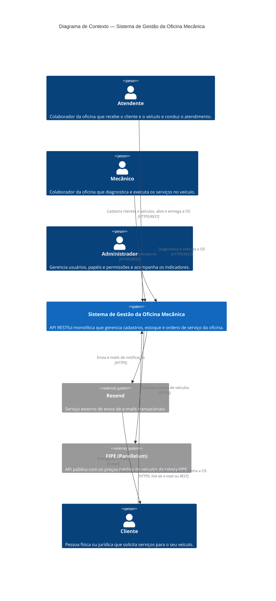

# C4 — Nível 1: Diagrama de Contexto do Sistema

Visão de mais alto nível do **Sistema de Gestão da Oficina Mecânica**: quem usa o sistema e com quais outros sistemas ele se relaciona.

## Elementos

### Pessoas

| Pessoa | Descrição | Principais interações |
|---|---|---|
| **Cliente** | Pessoa física ou jurídica que solicita serviços na oficina. | É cadastrado pelo Atendente. Recebe por e-mail o orçamento, com links para aprovar ou recusar, e o aviso de conclusão do serviço. Aprova ou recusa o orçamento pelo link do e-mail (sem login) ou pela API (com login). Pela API, também acompanha as próprias OS e consulta o catálogo de serviços. |
| **Atendente** | Colaborador que recebe o cliente e o veículo. | Identifica ou cadastra clientes e veículos; consulta o preço do veículo na tabela FIPE; cria a Ordem de Serviço; envia o orçamento para aprovação; confirma o pagamento; entrega o veículo. Mantém o catálogo de serviços, peças e insumos e o estoque. |
| **Mecânico** | Colaborador que realiza o trabalho técnico. | Inicia e conclui o diagnóstico; adiciona serviços e itens à OS; inicia a execução; conclui o serviço. |
| **Administrador** | Colaborador responsável pelo acesso ao sistema e pela gestão da oficina. | Gerencia usuários e papéis: consulta e exclui usuários, lista os papéis disponíveis e altera o papel de um usuário. Consulta os indicadores das ordens de serviço. |

> Atendente, Mecânico e Administrador são **Colaboradores** da oficina. No sistema, cada pessoa é um **Usuário** com um **Papel** que define suas permissões: `admin` (Administrador), `staff` (Atendente e Mecânico) e `client` (Cliente). Todos se autenticam com JWT. A exceção é a aprovação do orçamento pelo link do e-mail, em que o token do link é a credencial.

### Sistema

| Sistema | Descrição |
|---|---|
| **Sistema de Gestão da Oficina Mecânica** | API RESTful monolítica (NestJS + PostgreSQL) organizada nos bounded contexts: **Atendimento / Ordem de Serviço** (core), **Cadastros** e **Estoque** (suporte), **Identidade e Acesso** (genérico), **Notificações** e **Indicadores**. |

### Sistemas externos

| Sistema | Descrição | Integração |
|---|---|---|
| **[Resend](https://resend.com/)** | Serviço externo de e-mails transacionais. | O contexto de **Notificações** reage à mudança de status da Ordem de Serviço e chama a API REST do Resend, que envia o e-mail ao Cliente. São dois e-mails: **orçamento aguardando aprovação** (com os links para aprovar ou recusar) e **serviço concluído**. |
| **[FIPE (Parallelum)](https://fipe.parallelum.com.br/)** | API pública que expõe a tabela FIPE de preços médios de veículos. | O contexto de **Cadastros** consulta a API v2 da Parallelum para obter o preço de um veículo pelo código FIPE. O token de assinatura é opcional; sem ele, vale a cota pública. |

## Referências

- [ADR-001 — Escolha do Framework do Backend](../adr/adr-001-framework-backend.md)
- [ADR-002 — Escolha do Banco de Dados Principal](../adr/adr-002-banco-dados.md)
- [ADR-003 — Escolha da Arquitetura da Aplicação](../adr/adr-003-arquitetura.md)
- [ADR-004 — Escolha do ORM da Aplicação](../adr/adr-004-escolha-orm.md)
- [ADR-006 — Envio de E-mails Transacionais](../adr/adr-006-envio-emails.md)
- [ADR-011 — Aprovação do Orçamento da OS por Link no E-mail](../adr/adr-011-aprovacao-orcamento-por-email.md)
- [Event Storming — Criação da Ordem de Serviço](../ddd/README.md#criação-da-ordem-de-serviço)
- [Event Storming — Acompanhamento da Ordem de Serviço](../ddd/README.md#acompanhamento-da-ordem-de-serviço)
- [Linguagem Ubíqua — Oficina Mecânica](../ddd/linguagem-ubiqua.md)
