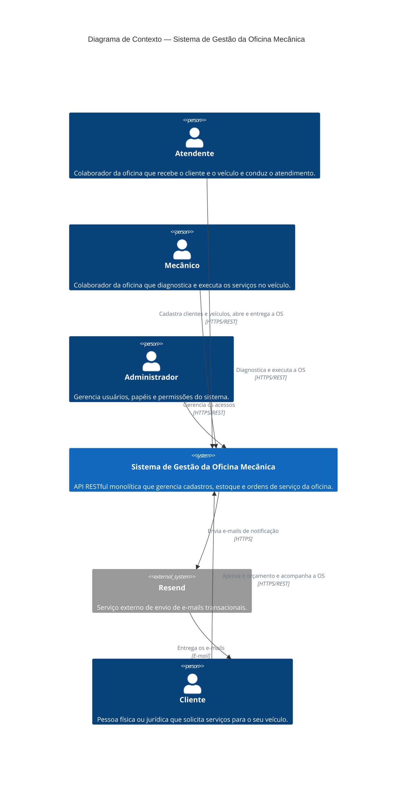

# C4 — Nível 1: Diagrama de Contexto do Sistema

Visão de mais alto nível do **Sistema de Gestão da Oficina Mecânica**: quem usa o sistema e com quais outros sistemas ele se relaciona.

## Elementos

### Pessoas

| Pessoa | Descrição | Principais interações |
|---|---|---|
| **Cliente** | Pessoa física ou jurídica que solicita serviços na oficina. | É cadastrado pelo Atendente; faz login no sistema; consulta o detalhe do orçamento; aprova ou recusa o orçamento; acompanha a Ordem de Serviço. Recebe as notificações por e-mail. |
| **Atendente** | Colaborador que recebe o cliente e o veículo. | Identifica ou cadastra clientes e veículos; registra os serviços solicitados; cria a Ordem de Serviço; entrega o veículo (ou devolve sem execução quando o orçamento é recusado). |
| **Mecânico** | Colaborador que realiza o trabalho técnico. | Inicia e conclui o diagnóstico; adiciona serviços e itens à OS; inicia a execução; consome itens; conclui o serviço. |
| **Administrador** | Colaborador responsável pelo acesso ao sistema. | Gerencia usuários, papéis e permissões (RBAC): consulta os usuários, lista os papéis disponíveis e altera o papel de um usuário. |

> Atendente, Mecânico e Administrador são **Colaboradores** da oficina. No sistema, cada pessoa é um **Usuário** com um **Papel** que define suas **Permissões** (RBAC): `admin` (Administrador), `staff` (Atendente e Mecânico) e `client` (Cliente). Todos se autenticam com JWT.

### Sistema

| Sistema | Descrição |
|---|---|
| **Sistema de Gestão da Oficina Mecânica** | API RESTful monolítica (NestJS + PostgreSQL) organizada nos bounded contexts: **Atendimento / Ordem de Serviço** (core), **Cadastros** e **Estoque** (suporte), **Identidade e Acesso** (genérico), **Notificações** e **Indicadores**. |

### Sistemas externos

| Sistema | Descrição | Integração |
|---|---|---|
| **[Resend](https://resend.com/)** | Serviço externo de e-mails transacionais. | O contexto de **Notificações** consome os eventos de domínio da Ordem de Serviço (ex.: *Orçamento gerado*) e chama a API REST do Resend, que envia o e-mail ao Cliente. |

## Referências

- ADR-001 — Escolha do Framework do Backend (NestJS + TypeScript)
- ADR-002 — Escolha do Banco de Dados Principal (PostgreSQL)
- ADR-003 — Escolha da Arquitetura da Aplicação (Clean Architecture)
- ADR-004 — Escolha do ORM da Aplicação (TypeORM)
- Event Storming — Jornada completa da Ordem de Serviço
- Bounded Contexts e Agregados / Context Map
- Linguagem Ubíqua — Oficina Mecânica
