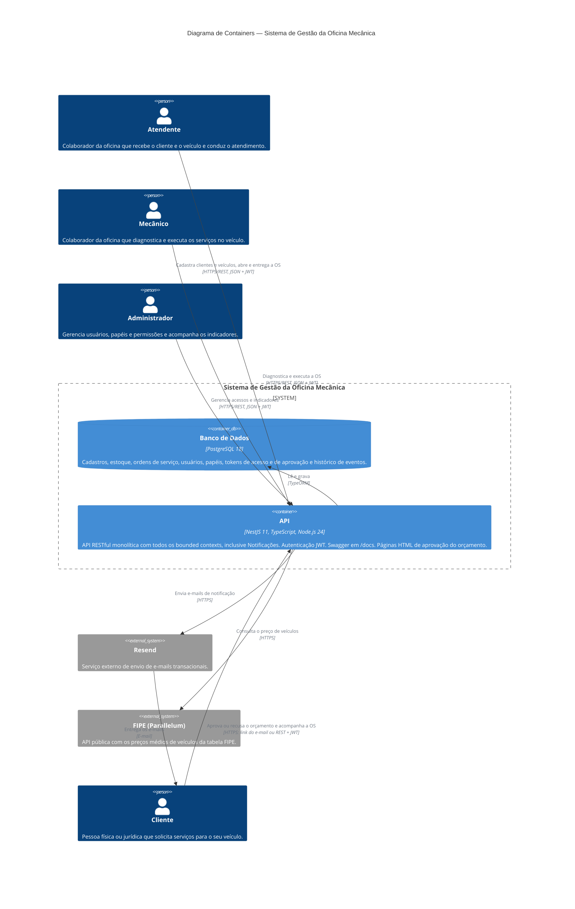

# C4 — Nível 2: Diagrama de Containers

Decomposição do **Sistema de Gestão da Oficina Mecânica** em suas unidades executáveis (containers), as tecnologias de cada uma e como se comunicam.

## Elementos

### Containers

| Container | Tecnologia | Responsabilidade |
|---|---|---|
| **API** | NestJS 11 + TypeScript (Node.js 24), Express como HTTP adapter | Único ponto de entrada do sistema. Expõe endpoints REST (porta 3000), com links HATEOAS nas respostas, e a documentação Swagger/OpenAPI em `/docs`. Autentica as pessoas com JWT (access token + refresh token opaco) e controla o acesso por papel (`admin`, `staff`, `client`). Também serve as **páginas HTML de aprovação do orçamento** (`/work-order-approvals`), abertas pelo link do e-mail, em que o token do link substitui o JWT. Organizada em Clean Architecture (domain, application, infrastructure) e contém todos os bounded contexts, inclusive **Notificações**, que é interno: reage aos eventos de domínio da Ordem de Serviço e chama o Resend. |
| **Banco de Dados** | PostgreSQL 18 | Fonte principal de persistência: clientes, veículos, catálogo de serviços, produtos, saldos e movimentações de estoque, ordens de serviço e seus itens, usuários (com perfis de cliente e colaborador), papéis, refresh tokens, tokens de aprovação do orçamento e o histórico de eventos (tabelas `events` e `event_types`). O schema é versionado por migrations do TypeORM (`synchronize: false`). |

### Pessoas

Cliente, Atendente, Mecânico e Administrador, conforme o [Diagrama de Contexto](01-system-context.md). Os colaboradores acessam a API via HTTPS/REST, autenticados com JWT. O sistema não tem um frontend próprio: a única interface HTML são as páginas de aprovação do orçamento, que o Cliente abre pelo link do e-mail. O Cliente também pode usar a API com JWT para acompanhar as próprias OS e decidir o orçamento. O Cliente é cadastrado pelo Atendente; os colaboradores têm o acesso gerenciado pelo Administrador.

### Sistemas externos

| Sistema | Integração |
|---|---|
| **[Resend](https://resend.com/)** | A API chama a API REST do Resend via HTTPS para enviar e-mails ao Cliente: orçamento aguardando aprovação (com os links de aprovação e recusa) e serviço concluído. Sem `RESEND_API_KEY`, a API funciona normalmente, mas não envia e-mails. |
| **[FIPE (Parallelum)](https://fipe.parallelum.com.br/)** | A API chama a API v2 da Parallelum via HTTPS para consultar o preço de um veículo pelo código FIPE (`GET /vehicles/fipe/:code`). |

## Execução

Os containers da solução são orquestrados via **Docker Compose** ([docker-compose.yml](../../docker-compose.yml)), na rede `app-network`, com as variáveis de ambiente lidas de `backend/.env` (modelo em `backend/.env.example`). Os containers usam o fuso `America/Sao_Paulo`. O [Diagrama de Implantação](05-deployment.md) mostra os nós, as imagens, as portas e os volumes.

- `backend`: API, construída a partir do `backend/Dockerfile` (`node:24-alpine`, executada sem root). Roda em modo de desenvolvimento (`start:dev`, com watch), com o código montado como volume. Só sobe depois que o banco está saudável (healthcheck).
- `postgres`: imagem `postgres:18-alpine`, com volume persistente `postgres_data`.

Ferramentas de apoio, que não fazem parte da solução:

- `adminer`: interface web para o banco (porta 8080). Sobe junto com o compose.
- `sonarqube` e `sonar-db`: análise estática de código (porta 9000). Só sobem com `docker compose --profile sonar up -d`.

Variáveis de ambiente relevantes para os containers:

| Variável | Uso |
|---|---|
| `JWT_SECRET` | Obrigatória. A API não sobe sem ela. |
| `AUTH_THROTTLE_LIMIT` | Opcional. Tentativas por minuto, por IP, no login e na renovação de token (padrão 20). |
| `DATABASE_*` | Conexão com o PostgreSQL. |
| `RESEND_API_KEY`, `EMAIL_FROM` | Envio de e-mails pelo Resend. |
| `EMAIL_REDIRECT_TO` | Opcional. Envia todos os e-mails para este endereço em vez do cliente (ex.: avaliação do projeto). |
| `APP_PUBLIC_URL` | Opcional. Endereço público da API usado nos links de aprovação do e-mail; sem valor, usa `http://localhost:<PORT>`. |
| `WORK_ORDER_APPROVAL_TTL_HOURS` | Validade, em horas, dos links de aprovação (padrão 72). |
| `FIPE_API_TOKEN` | Opcional. Token de assinatura da Parallelum; sem ele, vale a cota pública. |

## Referências

- [C4 — Nível 1: Diagrama de Contexto](01-system-context.md)
- [C4 — Diagrama de Implantação](05-deployment.md)
- [ADR-001 — Escolha do Framework do Backend](../adr/adr-001-framework-backend.md)
- [ADR-002 — Escolha do Banco de Dados Principal](../adr/adr-002-banco-dados.md)
- [ADR-003 — Escolha da Arquitetura da Aplicação](../adr/adr-003-arquitetura.md)
- [ADR-004 — Escolha do ORM da Aplicação](../adr/adr-004-escolha-orm.md)
- [ADR-006 — Envio de E-mails Transacionais](../adr/adr-006-envio-emails.md)
- [ADR-009 — Adoção de HATEOAS nas Respostas da API](../adr/adr-009-hateoas.md)
- [ADR-011 — Aprovação do Orçamento da OS por Link no E-mail](../adr/adr-011-aprovacao-orcamento-por-email.md)
- [ADR-013 — Análise Estática de Código com SonarQube](../adr/adr-013-analise-estatica-sonarqube.md)
- [Modelo de Dados](../database/README.md)
