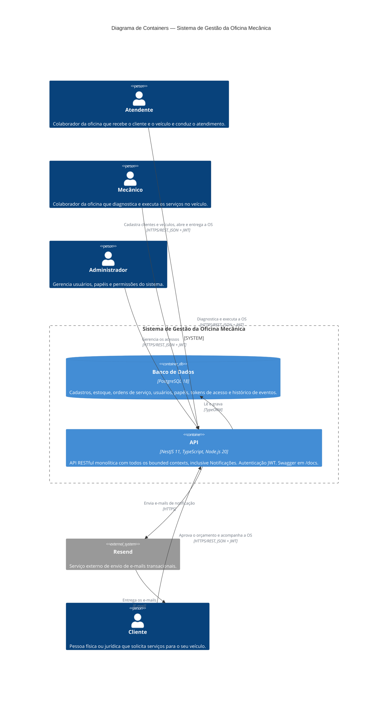

# C4 — Nível 2: Diagrama de Containers

Decomposição do **Sistema de Gestão da Oficina Mecânica** em suas unidades executáveis (containers), as tecnologias de cada uma e como se comunicam.

## Elementos

### Containers

| Container | Tecnologia | Responsabilidade |
|---|---|---|
| **API** | NestJS 11 + TypeScript (Node.js 20), Express como HTTP adapter | Único ponto de entrada do sistema. Expõe endpoints REST (porta 3000) e a documentação Swagger/OpenAPI em `/docs`. Autentica as pessoas com JWT (access token + refresh token) e controla o acesso por papel (RBAC: `admin`, `staff`, `client`). Organizada em Clean Architecture (domain, application, infrastructure) e contém todos os bounded contexts, inclusive **Notificações**, que é um módulo interno: reage aos eventos de domínio da Ordem de Serviço e chama o Resend. |
| **Banco de Dados** | PostgreSQL 18 | Fonte principal de persistência: clientes, veículos, catálogo, itens e movimentações de estoque, ordens de serviço, usuários (com perfis de cliente e colaborador), papéis, refresh tokens e o histórico de eventos (Event Store). O schema é versionado por migrations do TypeORM (`synchronize: false`). |

### Pessoas

Cliente, Atendente, Mecânico e Administrador, conforme o [Diagrama de Contexto](01-system-context.md). Todos acessam a API diretamente via HTTPS/REST, autenticados com JWT; não há frontend. O Cliente é cadastrado pelo Atendente; os colaboradores têm o acesso gerenciado pelo Administrador.

### Sistemas externos

| Sistema | Integração |
|---|---|
| **[Resend](https://resend.com/)** | A API chama a API REST do Resend via HTTPS para enviar e-mails ao Cliente (ex.: envio do orçamento para aprovação). |

## Execução

Os containers da solução são orquestrados via **Docker Compose** ([docker-compose.yml](../../docker-compose.yml)), na rede `app-network`, com as variáveis de ambiente lidas de `backend/.env` (modelo em `backend/.env.example`):

- `backend` — API, construída a partir do `backend/Dockerfile`; só sobe depois que o banco está saudável (healthcheck).
- `postgres` — imagem `postgres:18-alpine`, com volume persistente `postgres_data`.

## Referências

- [C4 — Nível 1: Diagrama de Contexto](01-system-context.md)
- ADR-001 — Escolha do Framework do Backend (NestJS + TypeScript)
- ADR-002 — Escolha do Banco de Dados Principal (PostgreSQL)
- ADR-003 — Escolha da Arquitetura da Aplicação (Clean Architecture)
- ADR-004 — Escolha do ORM da Aplicação (TypeORM)
- Bounded Contexts e Agregados / Context Map
- Modelagem do banco de dados
