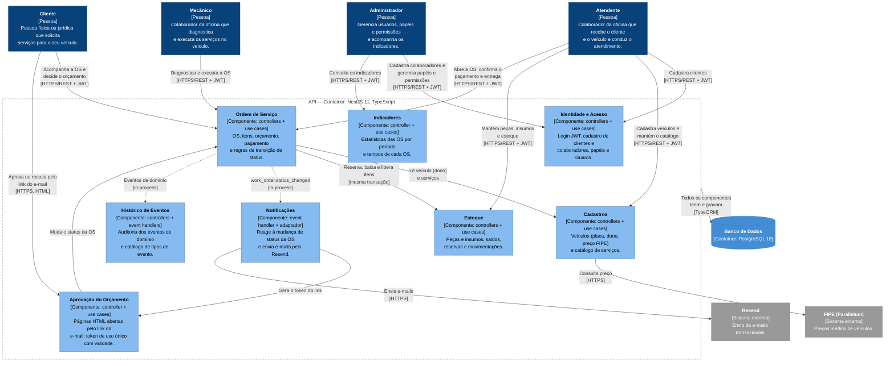

# C4 — Nível 3: Diagrama de Componentes (API)

Decomposição do container **API** em componentes. Cada componente agrupa os controllers, use cases e adaptadores que implementam um bounded context. O código fica num único `AppModule`, organizado por camada (ver [Organização do código](#organização-do-código)); os componentes são essa divisão lógica por contexto.



> **Notação:** este nível usa `flowchart` do Mermaid com as cores e rótulos do C4, em vez da sintaxe `C4Component`. Com o número de relações deste nível, o layout manual do `C4Component` gera sobreposições; o `flowchart` organiza setas e textos automaticamente. Setas contínuas são chamadas síncronas; setas pontilhadas são a publicação de eventos de domínio.
>
> **Setas omitidas** para não poluir o diagrama:
> - **Login e Guards:** todas as pessoas fazem login em Identidade e Acesso (`/auth/login`) e recebem um JWT, e as rotas de todos os componentes, exceto Aprovação do Orçamento, são protegidas pelos Guards de Identidade e Acesso (ver [Autenticação e autorização](#autenticação-e-autorização)).
> - **Eventos dos demais componentes:** Identidade e Acesso, Cadastros e Estoque também publicam eventos de domínio, gravados pelo Histórico de Eventos. Só a seta da Ordem de Serviço aparece.
> - **Consulta do histórico:** os colaboradores consultam o histórico de uma entidade em `/events`.
> - **Acesso ao banco:** uma única seta sai do container para o banco. Cada componente usa os próprios repositórios TypeORM; Notificações lê a OS, o cliente e o veículo, e Indicadores lê as OS e o histórico de eventos.

## Componentes

| Componente | Bounded context | Responsabilidade | Código | Requisitos atendidos |
|---|---|---|---|---|
| **Ordem de Serviço** | Atendimento / OS (core) | Criação da OS a partir do veículo (o cliente é o dono do veículo), inclusão, alteração e remoção de serviços e peças, cálculo do orçamento, confirmação do pagamento e máquina de status. Reserva, baixa e libera o estoque na mesma transação da mudança de status. Publica os eventos de domínio. | `WorkOrdersController` (`/work-orders`), use cases de `work-orders`, `WorkOrderQuoteService`, `WorkOrderUnitOfWork` | Criação e acompanhamento da OS; listagem e detalhamento; consulta e aprovação pelo cliente via API |
| **Aprovação do Orçamento** | Atendimento / OS (core) | Páginas HTML abertas pelo link do e-mail. O `GET` só mostra o orçamento e o botão de confirmação (filtros de e-mail abrem links automaticamente); o `POST` registra a decisão: aprovar muda a OS para `approved`, recusar muda para `cancelled`. O token é opaco, só o hash é gravado, vale por `WORK_ORDER_APPROVAL_TTL_HOURS` (padrão 72 h) e é de uso único: qualquer decisão sobre a OS revoga os links. | `WorkOrderApprovalsController` (`/work-order-approvals/:token/:decision`), use cases de `work-order-approvals` | Envio do orçamento para aprovação; aprovação pelo cliente |
| **Identidade e Acesso** | Identidade e Acesso (genérico) | Login com JWT (access token + refresh token opaco), renovação, logout e troca de senha. Cadastro de **clientes** e de **colaboradores**, criando o perfil e o usuário de acesso na mesma transação. Consulta, alteração e exclusão (lógica) de usuários. Gestão de papéis. Guards que protegem as rotas. | `AuthController` (`/auth`), `UsersController` (`/users`), `PermissionsController` (`/permissions`), `JwtAuthGuard`, `RolesGuard`, serviços de JWT, refresh token e hash scrypt | Autenticação JWT para APIs administrativas; identificação do cliente por CPF/CNPJ; CRUD de clientes; validação de CPF/CNPJ |
| **Cadastros** | Cadastros (suporte) | CRUD de veículos, cada um vinculado ao usuário dono (validação de placa), e consulta do preço na tabela FIPE. CRUD do catálogo de serviços (`repairs`). | `VehiclesController` (`/vehicles`), `RepairsController` (`/repairs`), `ParallelumFipeGateway` | CRUD de veículos e serviços; validação da placa |
| **Estoque** | Estoque (suporte) | CRUD de peças e insumos (`products`), com o saldo criado junto com o produto. Consulta de saldos (quantidade, reservado e disponível) e movimentações de entrada, saída e ajuste. | `ProductsController` (`/products`), `StockController` (`/stock`), use cases de `products` e `stock` | CRUD de peças e insumos; controle de estoque |
| **Notificações** | Notificações | Escuta `work_order.status_changed`. Em `awaiting_approval`, gera o token de aprovação e envia o orçamento com os links para aprovar ou recusar; em `completed`, avisa que o serviço foi concluído. Uma falha no envio é registrada em log e não desfaz a mudança de status. | `WorkOrderNotificationHandler`, `EmailWorkOrderNotifier`, `ResendEmailSender`, templates de e-mail | Envio do orçamento para aprovação |
| **Histórico de Eventos** | Transversal (auditoria) | Grava na tabela `events` os eventos de domínio de todos os contextos, por meio de handlers de auditoria. Expõe o histórico por entidade e o catálogo de tipos de evento. É a base dos Indicadores. | `EventsController` (`/events`), `EventTypesController` (`/event-types`), handlers `*-event-audit.handler` | Base do monitoramento do tempo médio de execução |
| **Indicadores** | Indicadores | Consultas de leitura sobre as OS e o histórico de eventos: OS iniciadas e concluídas, tempo médio de conclusão, tempo médio entre transições e foto por status, num período; e os tempos de cada etapa de uma OS. | `StatsController` (`/stats`), `GET /work-orders/:id/stats`, use cases de `work-order-stats` | Monitoramento do tempo médio de execução |

> **Cliente em Identidade e Acesso.** Por decisão do time, o perfil do **Cliente** é cadastrado junto com o seu usuário de acesso, no fluxo de usuários (`/users`), e por isso fica em **Identidade e Acesso**.

### Status da Ordem de Serviço e estoque

| Transição para | Efeito no estoque | Notificação |
|---|---|---|
| `awaiting_approval` | Reserva as peças e insumos da OS | E-mail com o orçamento e os links de aprovação |
| `approved` | Baixa a reserva e registra a saída (movimentação `OUT`) | — |
| `cancelled` (recusa) | Libera a reserva | — |
| `in_progress` | Só é permitida depois da confirmação do pagamento | — |
| `completed` | — | E-mail de serviço concluído |

O fluxo completo é `received` → `under_diagnosis` → `awaiting_approval` → `approved` → `in_progress` → `completed` → `delivered`, e `cancelled` só a partir de `awaiting_approval` (recusa do orçamento). Ver [ADR-010](../adr/adr-010-reserva-estoque-orcamento.md).

### Autenticação e autorização

| Papel (`role`) | Pessoas | Exemplos de acesso |
|---|---|---|
| `admin` | Administrador | Tudo o que `staff` acessa, mais: cadastro de colaboradores; exclusão de usuários; listagem de papéis e alteração do papel de um usuário (`/permissions`); indicadores (`/stats`) |
| `staff` | Atendente, Mecânico | Cadastro de clientes; consulta e alteração de usuários; veículos e FIPE; catálogo de serviços; produtos e estoque; criação da OS, itens, status e confirmação de pagamento; histórico e tipos de evento |
| `client` | Cliente | Consulta do catálogo de serviços; listagem e detalhe das próprias OS; tempos de uma OS; aprovação ou recusa do orçamento da própria OS (`PATCH /work-orders/:id/status`); dados do próprio usuário (`/users/me`) |

- O Guard **não é global**: cada rota declara a proteção com `@UseGuards(JwtAuthGuard, RolesGuard)` e `@Roles(...)`.
- `JwtAuthGuard` rejeita requisições sem token válido (**401**); `RolesGuard` rejeita papéis fora da lista de `@Roles` (**403**).
- O cadastro de usuários (`POST /users`) exige papel `staff` ou `admin`. O tipo do perfil vem no corpo (`entityType`: `client` ou `employee`); só o `admin` cadastra `employee`, e o novo colaborador recebe o papel `staff`.
- Pelo papel `client`, o cliente só muda o status da **própria** OS, e só de `awaiting_approval` para `approved` ou `cancelled`.
- As rotas `/auth/login`, `/auth/refresh` e `/auth/logout` e as páginas de `/work-order-approvals` não exigem JWT. Nas páginas de aprovação, o token do link é a credencial e só vale para a OS e o cliente a que pertence.

### Eventos de domínio

- Os use cases publicam os eventos pela porta `DomainEventPublisher`, implementada sobre o EventEmitter2 (`DomainEventEmitter`), **em memória e no mesmo processo**. O publisher aguarda os handlers.
- Os **handlers de auditoria** gravam cada evento na tabela `events`; o **handler de notificação** envia os e-mails. Ver [ADR-008](../adr/adr-008-eventos-dominio-auditoria.md).
- Os eventos de reserva, baixa e liberação de estoque (`stock.reserved`, `stock.consumed`, `stock.released`) são gravados direto na transação da OS.

### Transações

As operações que gravam mais de um registro rodam numa única transação, por meio de portas de Unit of Work implementadas com o TypeORM:

| Unit of Work | Operação |
|---|---|
| `UserRegistrationUnitOfWork` | Cadastro de cliente ou colaborador (perfil + usuário) |
| `ProductCreationUnitOfWork` | Cadastro de produto + saldo de estoque |
| `StockMovementUnitOfWork` | Movimentação + atualização do saldo |
| `WorkOrderUnitOfWork` | Mudanças na OS + reserva, baixa ou liberação do estoque + token de aprovação + eventos de estoque. A OS é travada (`pessimistic_write`) para evitar decisões concorrentes. |

## Organização do código

O código segue a Clean Architecture (ADR-003), organizado **por camada** e registrado num único `AppModule`. Os componentes deste diagrama são agrupamentos lógicos dessas camadas:

```
backend/src/
├── domain/              # entidades, value objects, eventos, interfaces de repositório, erros de domínio
├── application/
│   ├── use-cases/       # um diretório por contexto (work-orders, users, stock, ...)
│   ├── event-handlers/  # handlers de auditoria e de notificação
│   ├── services/        # serviços de aplicação (ex.: orçamento da OS)
│   └── ports/           # interfaces de saída (e-mail, FIPE, tokens, Unit of Work, ...)
├── infrastructure/
│   ├── http/            # controllers, DTOs, guards, HATEOAS, filtros e páginas HTML
│   ├── database/        # entidades ORM, mappers, repositórios, migrations e seeds
│   └── services/        # adaptadores técnicos (JWT, hash, Resend, FIPE, eventos)
└── shared/              # paginação e apresentação (marca, formatadores)
```

Os controllers chamam os use cases, que dependem das portas da camada de aplicação e das interfaces de repositório do domínio; as implementações ficam na infraestrutura.

## Pendências

- **Reposição de estoque.** Não há estoque mínimo, alerta de reposição nem pedido de compra: a reposição é registrada como uma entrada manual (`POST /stock/movements`, tipo `IN`). Falta definir se uma política de reposição entra no escopo e, se entrar, se ela gera uma notificação (e-mail) ou apenas um registro.

## Referências

- [C4 — Nível 1: Diagrama de Contexto](01-system-context.md)
- [C4 — Nível 2: Diagrama de Containers](02-container.md)
- [C4 — Nível 4: Diagrama de Código (Ordem de Serviço)](04-code.md)
- [ADR-003 — Escolha da Arquitetura da Aplicação](../adr/adr-003-arquitetura.md)
- [ADR-006 — Envio de E-mails Transacionais](../adr/adr-006-envio-emails.md)
- [ADR-008 — Eventos de Domínio e Registro de Auditoria](../adr/adr-008-eventos-dominio-auditoria.md)
- [ADR-009 — Adoção de HATEOAS nas Respostas da API](../adr/adr-009-hateoas.md)
- [ADR-010 — Reserva de Estoque no Envio do Orçamento](../adr/adr-010-reserva-estoque-orcamento.md)
- [ADR-011 — Aprovação do Orçamento da OS por Link no E-mail](../adr/adr-011-aprovacao-orcamento-por-email.md)
- [ADR-012 — Cálculo das Estatísticas a partir do Histórico de Eventos](../adr/adr-012-estatisticas-por-eventos.md)
- [Event Storming — Criação da Ordem de Serviço](../ddd/README.md#criação-da-ordem-de-serviço)
- [Event Storming — Acompanhamento da Ordem de Serviço](../ddd/README.md#acompanhamento-da-ordem-de-serviço)
- [Event Storming — Gestão de peças e insumos](../ddd/README.md#gestão-de-peças-e-insumos)
