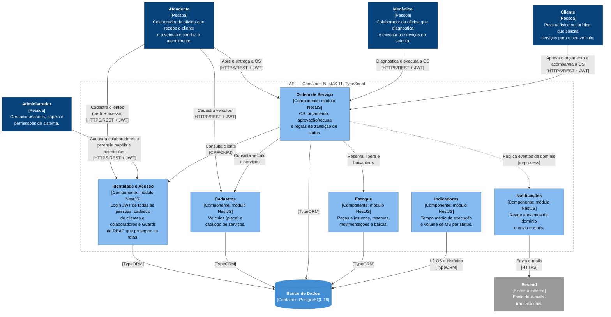

# C4 — Nível 3: Diagrama de Componentes (API)

> **Status: RASCUNHO — arquitetura-alvo.** Este diagrama descreve como a API **deve** ser organizada, com base na documentação DDD e no código da branch `feat/user-auth` (ainda não mesclada na `develop`). Ele ainda não corresponde integralmente ao código (ver [Situação do código](#situação-do-código)) e precisa ser revisado antes da entrega para refletir o commit final.

Decomposição do container **API** em componentes. Cada componente é um módulo NestJS que implementa um bounded context.



> **Notação:** este nível usa `flowchart` do Mermaid com as cores e rótulos do C4, em vez da sintaxe `C4Component`. Com o número de relações deste nível, o layout manual do `C4Component` gera sobreposições; o `flowchart` organiza setas e textos automaticamente. Setas contínuas são chamadas síncronas; a seta pontilhada é a publicação de eventos de domínio.
>
> **Login e Guards não aparecem como setas** para não poluir o diagrama: **todas as pessoas** fazem login em Identidade e Acesso (`/auth/login`) e recebem um JWT, e as rotas de **todos os módulos** são protegidas pelos Guards de Identidade e Acesso (ver [Autenticação e autorização](#autenticação-e-autorização)).

## Componentes

| Componente | Bounded context | Responsabilidade | Agregados / conceitos | Requisitos do enunciado atendidos |
|---|---|---|---|---|
| **Ordem de Serviço** | Atendimento / OS (core) | Criação da OS, inclusão de serviços e itens, geração automática do orçamento, aprovação/recusa, máquina de status e regras de transição. Consulta o cliente em Identidade e Acesso e o veículo e os serviços em Cadastros. Publica os eventos de domínio. | `OrdemDeServico` (raiz), `Orcamento`, `ItemDaOS`; VOs `NumeroOS`, `StatusOS`, `Dinheiro` | Criação e acompanhamento da OS; listagem e detalhamento; consulta pelo cliente via API |
| **Identidade e Acesso** | Identidade e Acesso (genérico) | Login com JWT (access token + refresh token opaco), logout e troca de senha. Cadastro de **clientes** (feito pelo Atendente) e de **colaboradores** (feito pelo Administrador), criando o perfil e o usuário de acesso na mesma operação. Gestão de papéis e permissões. Guards que protegem as rotas. | `Usuario`, `Papel`, `RefreshToken`; perfis `Cliente` e `Colaborador` | Autenticação JWT para APIs administrativas; identificação do cliente por CPF/CNPJ; CRUD de clientes; validação de CPF/CNPJ |
| **Cadastros** | Cadastros (suporte) | CRUD de veículos (validação de placa) e do catálogo de serviços. | `Veiculo`, `ServicoCatalogo` | CRUD de veículos e serviços; validação da placa |
| **Estoque** | Estoque (suporte) | CRUD de peças e insumos, reserva após aprovação, liberação após cancelamento, baixa no consumo, solicitação de reposição. | `ItemDeEstoque` (raiz), `Reserva`, `Movimentacao`; VOs `SKU`, `Quantidade` | CRUD de peças e insumos; controle de estoque |
| **Notificações** | Notificações | Escuta os eventos de domínio da OS (ex.: *Orçamento gerado*) e envia e-mails ao cliente pela API do Resend. | Consumidor de eventos | Envio do orçamento para aprovação |
| **Indicadores** | Indicadores | Consultas de leitura: tempo médio de execução e volume de OS por status. | Projeções de leitura | Monitoramento do tempo médio de execução |

> **Cliente em Identidade e Acesso.** Por decisão do time, o perfil do **Cliente** é cadastrado junto com o seu usuário de acesso, no fluxo de usuários (`/users`), e por isso fica em **Identidade e Acesso**. O documento *Bounded Contexts e Agregados* ainda posiciona `Cliente` em **Cadastros** e precisa ser atualizado para manter a documentação DDD coerente com o código.

### Autenticação e autorização

| Papel (`role`) | Pessoas | Exemplos de acesso |
|---|---|---|
| `admin` | Administrador | Cadastro de colaboradores; listagem de papéis e alteração do papel de um usuário (`/permissions`) |
| `staff` | Atendente, Mecânico | Cadastro de clientes; listagem de usuários; rotas administrativas de OS, Cadastros e Estoque |
| `client` | Cliente | Consulta e aprovação do orçamento; acompanhamento da OS |

- O Guard **não é global**: cada rota declara a proteção com `@UseGuards(JwtAuthGuard, RolesGuard)` e `@Roles(...)`.
- `JwtAuthGuard` rejeita requisições sem token válido (**401**); `RolesGuard` rejeita papéis fora da lista de `@Roles` (**403**).
- O cadastro de clientes (`POST /users`) exige papel `staff` ou `admin`; o cadastro de colaboradores (`POST /users/employees`) exige papel `admin`.

### Organização interna de cada componente

Cada módulo segue a Clean Architecture já adotada no projeto (ADR-003):

```
<modulo>/
├── domain/           # entidades, value objects, interfaces de repositório, erros de domínio
├── application/      # use cases (ex.: AbrirOrdemDeServico, AprovarOrcamento) e ports
└── infrastructure/
    ├── http/         # controllers, DTOs e guards
    ├── database/     # entidades ORM, mappers e repositórios TypeORM
    └── services/     # adaptadores técnicos (ex.: JWT, hash de senha, cliente do Resend)
```

Um módulo só acessa outro através dos **use cases** ou de uma interface pública exportada, nunca pelo repositório ou pelas entidades ORM do outro módulo.

## Suposições deste rascunho

Pontos que ainda não foram decididos pelo time. O diagrama foi desenhado com a opção indicada; se a decisão for outra, ele precisa ser ajustado.

| # | Tema | Suposição adotada | Impacto se mudar |
|---|---|---|---|
| S1 | Organização do código | Um módulo NestJS por bounded context, cada um com `domain`, `application` e `infrastructure`. | O código atual está organizado só por camadas num único `AppModule`. Se continuar assim, os componentes passam a ser camadas (Controllers, Use Cases, Domain, Repositories) em vez de contextos. |
| S2 | Eventos de domínio | Publicados em memória (ex.: `@nestjs/event-emitter`), dentro do mesmo processo. | Se forem gravados na tabela `events` (Event Store) e lidos depois, entra uma relação de Notificações/Indicadores com o banco. |
| S3 | Transações | Operações que gravam mais de um registro rodam numa única transação, via `QueryRunner`/Unit of Work do TypeORM. Exemplos: cadastrar cliente ou colaborador (perfil + usuário), aprovar orçamento + reservar itens, concluir serviço + baixar estoque. | Hoje o cadastro de usuário grava o perfil e depois o usuário sem transação: se a segunda gravação falhar, sobra um perfil sem usuário. Define também como Ordem de Serviço e Estoque se comunicam (chamada síncrona na mesma transação vs. evento). |
| S4 | Indicadores | Calculados por consulta direta no banco (sem projeções alimentadas por eventos). | Se usar projeções, entra uma seta pontilhada de Ordem de Serviço para Indicadores. |

### Decisões já tomadas

- **Acesso do Cliente:** o Cliente se autentica com JWT (papel `client`), como os colaboradores.
- **Cadastro do Cliente:** feito pelo Atendente, em Identidade e Acesso (perfil + usuário de acesso).
- **Cadastro de colaboradores:** feito pelo Administrador.

## Pendências

- **Componentes sem ator no C1.** O CRUD do catálogo de serviços, o CRUD de peças e insumos, o controle de estoque e a consulta de Indicadores são obrigatórios pelo enunciado, mas nenhuma pessoa do C1 está associada a eles. Estoque e Indicadores aparecem no diagrama sem seta de entrada de uma pessoa.
- **Reposição de estoque.** O Event Storming de peças e insumos tem a política *Solicitar reposição*; ainda não está definido se ela gera uma notificação (e-mail) ou apenas um registro.
- **Documentação DDD.** Atualizar *Bounded Contexts e Agregados* para mover `Cliente` de Cadastros para Identidade e Acesso.

## Situação do código

Referência: branch `feat/user-auth`, ainda não mesclada na `develop`. O código está organizado **por camada**, num único `AppModule`, e implementa parte de dois componentes:

| Código atual | Componente alvo | Observação |
|---|---|---|
| `AuthController` (`/auth/login`, `/auth/refresh`, `/auth/logout`, `/auth/password`) + use cases de `auth` | Identidade e Acesso | Implementado |
| `UsersController` (`/users`) + use cases de `users` | Identidade e Acesso | Cria cliente e colaborador com perfil (`ProfileRepository`). **A implementar:** Guard `staff`/`admin` no `POST /users` (hoje é público) e ativar o `POST /users/employees` com papel `admin` (hoje comentado). |
| `PermissionsController` (`/permissions`) + use cases de `permissions` | Identidade e Acesso | Implementado, restrito ao papel `admin` |
| `application/ports` + `infrastructure/services` (JWT, refresh token opaco, hash scrypt) | Identidade e Acesso | Implementado |
| `ServiceTypesController` (`/service-types`) + use cases de `service-types` | Cadastros (catálogo de serviços) | **A implementar:** proteção das rotas com JWT e papel |

## Referências

- [C4 — Nível 1: Diagrama de Contexto](01-system-context.md)
- [C4 — Nível 2: Diagrama de Containers](02-container.md)
- ADR-003 — Escolha da Arquitetura da Aplicação (Clean Architecture)
- Bounded Contexts e Agregados / Context Map
- Event Storming — Jornada completa da Ordem de Serviço
- Event Storming — Gestão de peças e insumos
- Enunciado — Fase 1 Tech Challenge
