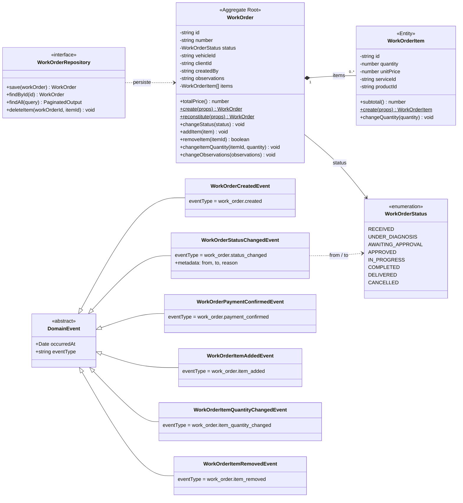
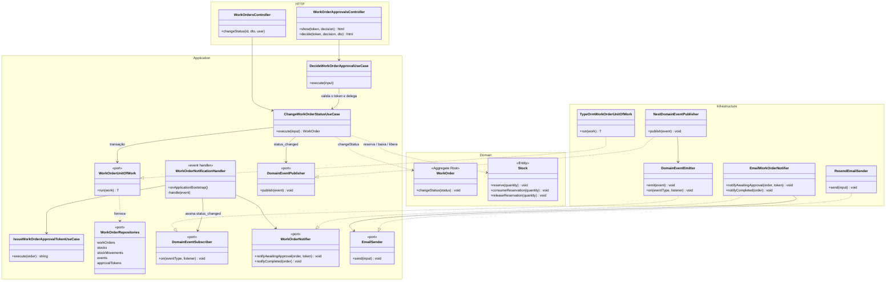

# C4 — Nível 4: Diagrama de Código (Ordem de Serviço)

Detalhamento, em notação de diagrama de classes UML, do componente **Ordem de Serviço** do [Diagrama de Componentes](03-component.md). É o domínio principal (core) e o componente com mais regras de negócio.

> O nível 4 do C4 é opcional e muda junto com o código. Por isso ele cobre só este componente e mostra as classes e métodos relevantes para entender o desenho, não todos os membros. A fonte é o código em [`backend/src`](../../backend/src).

O componente é mostrado em duas visões:

1. **[Agregado Ordem de Serviço](#1-agregado-ordem-de-serviço):** o modelo de domínio, com as regras de negócio.
2. **[Mudança de status da OS](#2-mudança-de-status-da-os):** como uma requisição atravessa as camadas, do controller ao banco e ao e-mail.

## 1. Agregado Ordem de Serviço

### Regras do agregado

`WorkOrder` é a raiz do agregado: os itens só são alterados por ela, e as regras abaixo valem em qualquer caminho de uso.

| Regra | Onde |
|---|---|
| Só são aceitas as transições `received` → `under_diagnosis` → `awaiting_approval` → `approved` → `in_progress` → `completed` → `delivered`, e `awaiting_approval` → `cancelled`. As demais lançam `InvalidWorkOrderError`. | `WorkOrder.changeStatus` |
| Só vai para `awaiting_approval` com ao menos um item. | `WorkOrder.changeStatus` |
| Os itens só podem ser incluídos, alterados ou removidos enquanto a OS está `received` ou `under_diagnosis`, isto é, antes do envio do orçamento. | `WorkOrder.ensureItemsCanChange` (chamado por `addItem`, `removeItem` e `changeItemQuantity`) |
| Um item não pode ser incluído duas vezes; alterar ou remover um item inexistente é erro. | `WorkOrder.addItem`, `removeItem`, `changeItemQuantity` |
| O valor total é sempre a soma dos subtotais (quantidade × preço unitário); não é informado de fora. | `WorkOrder.totalPrice`, `WorkOrderItem.subtotal` |
| Veículo, cliente e colaborador responsável são obrigatórios; o status inicial é `received`. | `WorkOrder.create` |
| Cada item referencia um serviço **ou** uma peça/insumo, com quantidade maior que zero. | `WorkOrderItem.create` (e `CHECK` no banco) |

Os eventos não são publicados pelo agregado: os use cases criam o evento depois de gravar a OS e o publicam pela porta `DomainEventPublisher` (ver a visão 2).

## 2. Mudança de status da OS

Fluxo de `PATCH /work-orders/:id/status` e da decisão do cliente pelo link do e-mail (`POST /work-order-approvals/:token/:decision`). É o fluxo que mais envolve outras partes do sistema: estoque, token de aprovação, eventos e e-mail.

> **Notação UML:** `-->` associação/dependência de uso; `..|>` implementação de interface (porta); `..>` dependência; `*--` composição; `<|--` herança. Estereótipos: `<<port>>` são interfaces da camada de aplicação, implementadas na infraestrutura (inversão de dependência, ADR-003).

### Sequência

1. O **controller** recebe o novo status e o usuário autenticado e chama `ChangeWorkOrderStatusUseCase`. No link do e-mail, `DecideWorkOrderApprovalUseCase` valida o token, identifica o cliente e chama o mesmo use case.
2. O use case abre uma transação com `WorkOrderUnitOfWork.run`. A implementação `TypeOrmWorkOrderUnitOfWork` usa `DataSource.transaction` e entrega os repositórios ligados à mesma transação (`WorkOrderRepositories`). A OS é lida com trava `pessimistic_write`, para que dois cliques simultâneos não decidam a mesma OS duas vezes.
3. Dentro da transação, conforme o status de destino:
   - `awaiting_approval`: `Stock.reserve` para cada peça/insumo da OS;
   - `approved`: `Stock.consumeReservation` e uma movimentação de saída;
   - `cancelled`: `Stock.releaseReservation`;
   - `in_progress`: exige a confirmação de pagamento no histórico da OS.

   Depois, `WorkOrder.changeStatus` aplica a regra de transição; ao sair de `awaiting_approval`, os links de aprovação são revogados. Se qualquer passo falhar, nada é gravado.
4. Depois do commit, o use case publica `WorkOrderStatusChangedEvent` pela porta `DomainEventPublisher`. `NestDomainEventPublisher` repassa ao `DomainEventEmitter` (EventEmitter2, no mesmo processo).
5. `WorkOrderNotificationHandler`, inscrito em `work_order.status_changed`, reage:
   - `awaiting_approval`: gera o token com `IssueWorkOrderApprovalTokenUseCase` e envia o orçamento com os links;
   - `completed`: envia o aviso de serviço concluído.

   O e-mail sai por `EmailWorkOrderNotifier` → `ResendEmailSender`. Uma falha no envio é registrada em log e não desfaz a mudança de status.

O mesmo evento também é gravado no histórico pelo handler de auditoria (`WorkOrderEventAuditHandler`), omitido no diagrama.

## Referências

- [C4 — Nível 3: Diagrama de Componentes](03-component.md)
- [ADR-003 — Escolha da Arquitetura da Aplicação](../adr/adr-003-arquitetura.md)
- [ADR-008 — Eventos de Domínio e Registro de Auditoria](../adr/adr-008-eventos-dominio-auditoria.md)
- [ADR-010 — Reserva de Estoque no Envio do Orçamento](../adr/adr-010-reserva-estoque-orcamento.md)
- [ADR-011 — Aprovação do Orçamento da OS por Link no E-mail](../adr/adr-011-aprovacao-orcamento-por-email.md)
- [Linguagem Ubíqua](../ddd/linguagem-ubiqua.md)
- [Modelo de Dados](../database/README.md)
