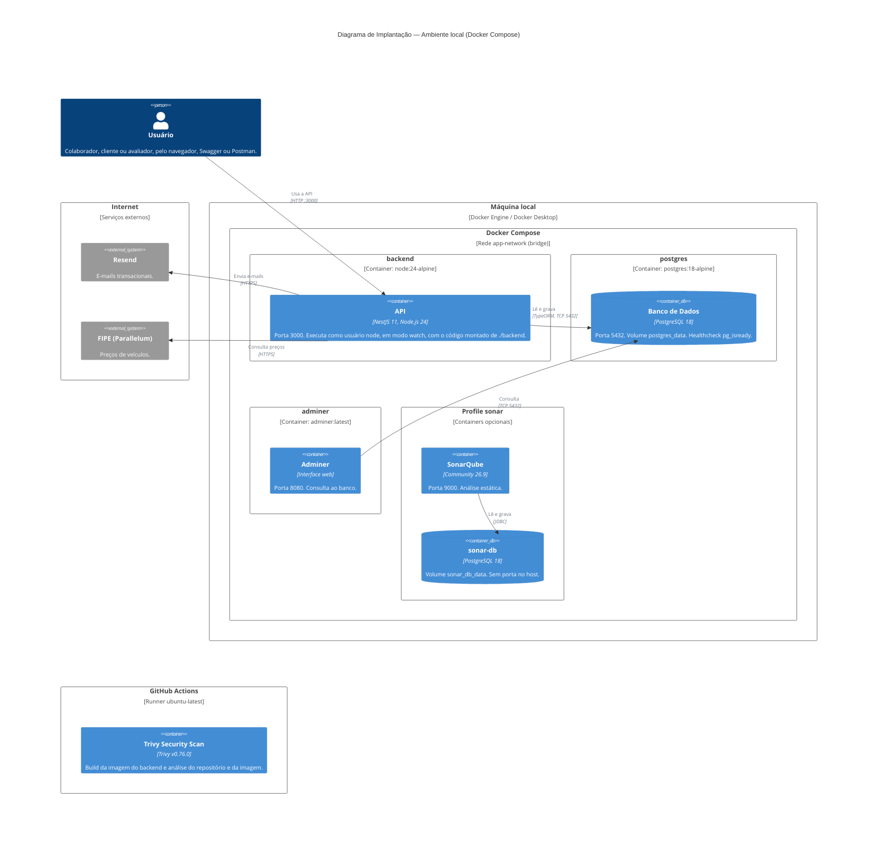

# C4 — Diagrama de Implantação (Deployment)

Diagrama complementar do C4: mostra **onde** os containers do [Nível 2](02-container.md) são executados — nós de infraestrutura, imagens, portas, volumes e redes.

> **Ambiente representado.** O sistema é executado localmente via Docker Compose, para desenvolvimento e avaliação. Não há ambiente de produção nem deploy em nuvem (ver o escopo excluído no [DAS](../das/das-001-sistema-gestao-oficina.md#22-escopo-excluído)). O diagrama também mostra o GitHub Actions, onde roda a análise de vulnerabilidades.

> **Imagem:** [05-deployment.png](05-deployment.png), com fundo branco.

## Elementos

### Máquina local (Docker Compose)

Definida em [docker-compose.yml](../../docker-compose.yml). Todos os containers ficam na rede `app-network` (driver `bridge`) e se comunicam pelo nome do serviço (ex.: a API acessa o banco em `postgres:5432`).

| Container | Imagem | Porta no host | Volumes | Observações |
|---|---|---|---|---|
| `backend` | Build de [backend/Dockerfile](../../backend/Dockerfile), sobre `node:24-alpine` | 3000 | `./backend:/app` (código) e volume anônimo em `/app/node_modules` | Executa como usuário `node`, com `npm run start:dev` (watch). Variáveis lidas de `backend/.env`; `DATABASE_HOST=postgres`. Só sobe depois que o `postgres` está saudável. |
| `postgres` | `postgres:18-alpine` | 5432 | `postgres_data` | Usuário, senha e banco vêm de `backend/.env`. Healthcheck com `pg_isready` a cada 5 s. |
| `adminer` | `adminer:latest` | 8080 | — | Ferramenta de apoio para consultar o banco; servidor padrão `postgres`. Reinicia sempre (`restart: always`). |
| `sonarqube` | `sonarqube:26.9.0.129388-community` | 9000 | `sonarqube_data`, `sonarqube_extensions`, `sonarqube_logs` | Só sobe com `docker compose --profile sonar up -d`. Depende do `sonar-db` saudável. |
| `sonar-db` | `postgres:18-alpine` | — | `sonar_db_data` | Banco exclusivo do SonarQube, acessível apenas pela rede interna. Só sobe com o profile `sonar`. |

Os containers `backend` e `postgres` usam o fuso `America/Sao_Paulo`, inclusive no `now()` do banco.

`backend` e `postgres` formam a solução; `adminer`, `sonarqube` e `sonar-db` são ferramentas de apoio ao desenvolvimento.

### GitHub Actions

| Job | Ambiente | O que faz |
|---|---|---|
| `repository` | `ubuntu-latest` | Trivy sobre o repositório: dependências (`package-lock.json`), *secrets* e configuração do `Dockerfile`. |
| `image` | `ubuntu-latest` | Build da imagem do backend (`docker build ./backend`) e Trivy sobre a imagem (SO e pacotes Node.js). |

Definido em [.github/workflows/trivy.yml](../../.github/workflows/trivy.yml). Executa em todo *pull request*, em push para `main` e `develop`, semanalmente e sob demanda, com as *actions* fixadas por SHA ([ADR-014](../adr/adr-014-analise-vulnerabilidades-trivy.md)).

### Serviços externos

| Sistema | Acesso | Configuração |
|---|---|---|
| **Resend** | HTTPS, a partir do container `backend` | `RESEND_API_KEY` e `EMAIL_FROM`; sem chave, a API não envia e-mails |
| **FIPE (Parallelum)** | HTTPS, a partir do container `backend` | `FIPE_API_TOKEN` opcional; sem ele, vale a cota pública |

## Referências

- [C4 — Nível 2: Diagrama de Containers](02-container.md)
- [ADR-013 — Análise Estática de Código com SonarQube](../adr/adr-013-analise-estatica-sonarqube.md)
- [ADR-014 — Análise de Vulnerabilidades com Trivy](../adr/adr-014-analise-vulnerabilidades-trivy.md)
- [Relatório — Análise de Vulnerabilidades com Trivy](../reports/analise-vulnerabilidades-trivy.md)
