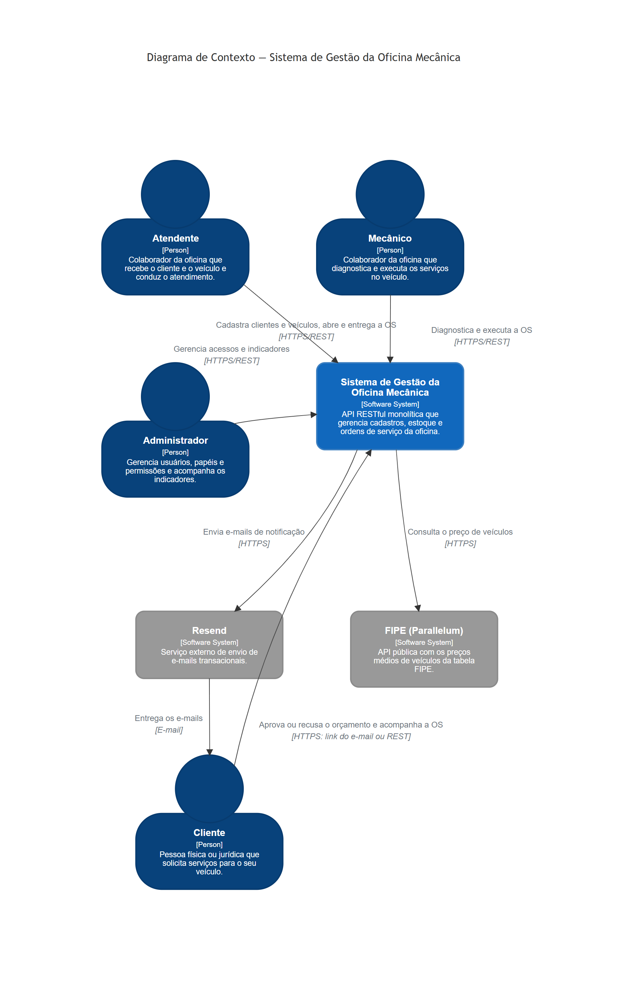
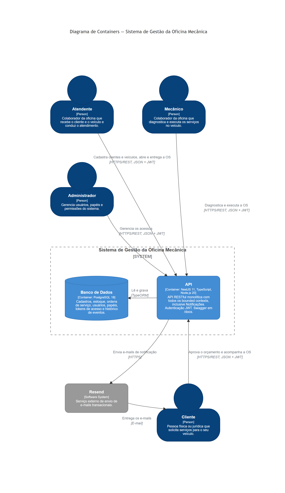
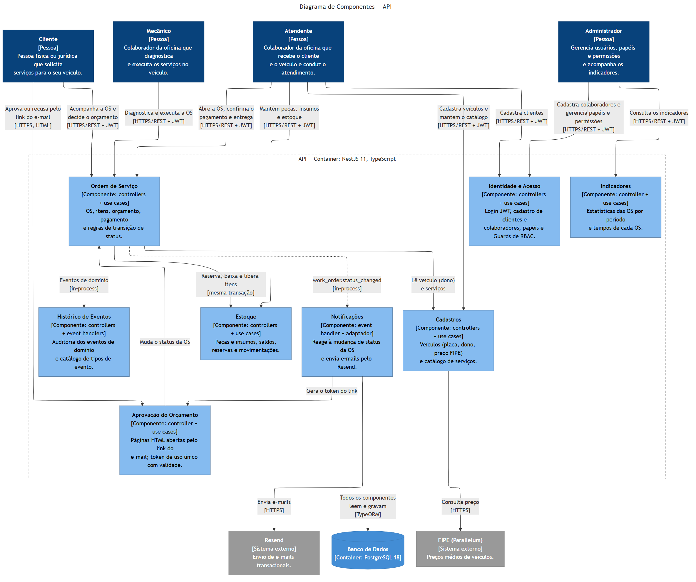
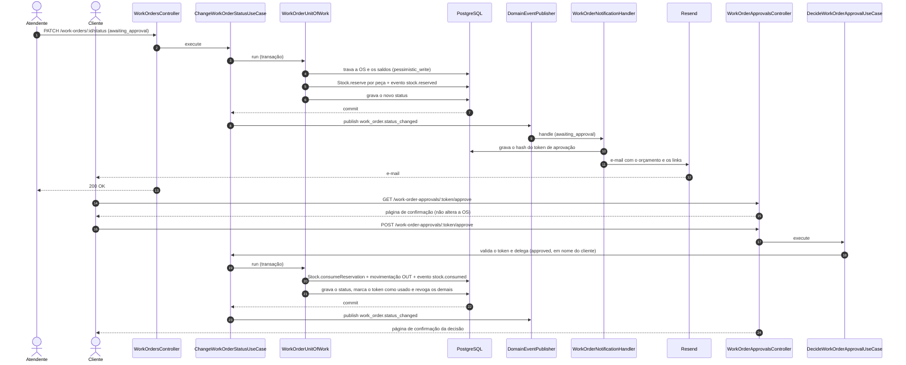

# DAS — Design Approval Sheet

## Título da Solução
Sistema de Gestão da Oficina Mecânica — back-end (MVP)

## Autor(es)
Felipe Santana, Julio Cavalcanti, Kevin Villanova, Matheus Andrell e Michel Lisboa

## Data
27/10/2026

## Versão

| Versão | Data | Descrição |
|---|---|---|
| 1.0 | 27/10/2026 | Versão inicial, referente à entrega do MVP |

## Identificador
DAS-001

---

## 1. Objetivo da Solução

Substituir as anotações manuais e planilhas da oficina por uma API que organize o atendimento de ponta a ponta: identificação do cliente, cadastro do veículo, abertura da Ordem de Serviço (OS), orçamento com aprovação pelo cliente, controle de peças e insumos, acompanhamento do status e indicadores de tempo de execução, com rastreabilidade de todas as operações.

---

## 2. Escopo

### 2.1 Escopo Incluído
- Identificação e cadastro de clientes (CPF/CNPJ) e de seus veículos, com consulta de preço na tabela FIPE
- Abertura da OS, inclusão de serviços, peças e insumos e geração automática do orçamento
- Envio do orçamento por e-mail e aprovação ou recusa pelo cliente, pela API ou pelo link do e-mail
- Acompanhamento da OS por status, com regras de transição e consulta pelo cliente
- Catálogo de serviços, peças e insumos e controle de estoque com reserva, baixa e liberação
- Confirmação de pagamento antes da execução
- Histórico de auditoria de todas as entidades e indicadores das OS, incluindo o tempo médio de execução
- Autenticação JWT e controle de acesso por papel (`admin`, `staff`, `client`)

### 2.2 Escopo Excluído
- Frontend ou aplicativo: a única interface são as páginas HTML de aprovação do orçamento
- Processamento de pagamentos: o sistema apenas registra a confirmação feita pela equipe
- Orçamento complementar: após o envio, a OS não aceita novos itens
- Política de reposição de estoque (estoque mínimo, alertas e pedidos de compra)
- Notificações por outros canais além do e-mail (SMS, push, WhatsApp)
- Mensageria externa: os eventos de domínio são publicados em memória
- Ambiente de produção em nuvem, monitoramento e alertas

---

## 3. Tecnologias Utilizadas

| Componente | Tecnologia / Ferramenta |
|---|---|
| Backend | Node.js 24, NestJS 11 (Express), TypeScript |
| Frontend | Não se aplica (páginas HTML de aprovação servidas pela API) |
| Banco de Dados | PostgreSQL 18, TypeORM 0.3 com migrations |
| Mensageria | Eventos de domínio em memória (EventEmitter2), sem broker |
| Integração APIs | REST com OpenAPI/Swagger e HATEOAS; Resend (e-mail); API FIPE da Parallelum |
| Segurança | JWT com refresh token opaco, hash scrypt para senhas, SHA-256 para tokens de aprovação |
| Qualidade | Jest, ESLint, Prettier, SonarQube, Trivy |
| Observabilidade | Logs da aplicação (Logger do NestJS) e histórico de eventos no banco |
| Infraestrutura | Docker, Docker Compose, GitHub Actions |

---

## 4. Requisitos

A lista completa, com regras de negócio, restrições e rastreabilidade, está em [Requisitos](../requirements/README.md). Os principais:

### 4.1 Requisitos Funcionais
- RF-01: Identificar o cliente pelo CPF ou CNPJ
- RF-05: Abrir a OS para um veículo, com número sequencial por ano
- RF-06 e RF-07: Incluir serviços, peças e insumos e gerar o orçamento automaticamente
- RF-08 a RF-10: Enviar o orçamento e registrar a aprovação ou recusa pelo cliente
- RF-11 e RF-13: Alterar o status da OS e permitir ao cliente acompanhar o andamento
- RF-15 a RF-20: CRUD de clientes, veículos, serviços, peças e insumos e controle de estoque
- RF-22: Indicadores das OS, incluindo o tempo médio de execução

### 4.2 Requisitos Não Funcionais
- RNF-01: Rotas administrativas autenticadas (401 sem token, 403 com papel insuficiente)
- RNF-05: Zero vulnerabilidades `HIGH`/`CRITICAL` com correção disponível
- RNF-06 e RNF-07: Operações atômicas e seguras sob concorrência
- RNF-08: Falhas em e-mail e auditoria não desfazem a operação de negócio
- RNF-13: Cobertura mínima de 80% de linhas nos domínios críticos

---

## 5. Arquitetura da Solução

API RESTful **monolítica**, organizada em **Clean Architecture** (domain, application, infrastructure) e modelada com **DDD**. O domínio é dividido em bounded contexts — Atendimento / Ordem de Serviço (core), Estoque, Cadastros, Identidade e Acesso, Notificações, Histórico de Eventos e Indicadores — que compartilham o mesmo processo e o mesmo banco.

- **Fluxo principal:** a mudança de status da OS e as alterações de estoque (reserva, baixa e liberação) ocorrem na mesma transação, por meio de uma *Unit of Work*, com bloqueio pessimista da OS e dos saldos.
- **Comunicação entre contextos:** chamadas diretas entre casos de uso e eventos de domínio publicados em memória. Auditoria e notificações reagem aos eventos, sem que os casos de uso as conheçam.
- **Integrações externas:** Resend e FIPE, isoladas por portas (`EmailSender`, `FipeGateway`) implementadas na infraestrutura.

As decisões arquiteturais estão registradas nos ADRs:

| ADR | Decisão |
|---|---|
| [ADR-001](../adr/adr-001-framework-backend.md) | NestJS + TypeScript como framework |
| [ADR-002](../adr/adr-002-banco-dados.md) | PostgreSQL como banco de dados principal |
| [ADR-003](../adr/adr-003-arquitetura.md) | Clean Architecture |
| [ADR-004](../adr/adr-004-escolha-orm.md) | TypeORM como ORM |
| [ADR-005](../adr/adr-005-escolha-termos-ingles.md) | `Repair` como termo para Serviço |
| [ADR-006](../adr/adr-006-envio-emails.md) | Resend e envio de e-mails por eventos de domínio |
| [ADR-007](../adr/adr-007-padrao-listagem.md) | Padrão único de paginação, busca, ordenação e filtros |
| [ADR-008](../adr/adr-008-eventos-dominio-auditoria.md) | Eventos de domínio em memória e tabela única de auditoria |
| [ADR-009](../adr/adr-009-hateoas.md) | HATEOAS nas respostas da API |
| [ADR-010](../adr/adr-010-reserva-estoque-orcamento.md) | Reserva de estoque no envio do orçamento |
| [ADR-011](../adr/adr-011-aprovacao-orcamento-por-email.md) | Aprovação do orçamento por link no e-mail |
| [ADR-012](../adr/adr-012-estatisticas-por-eventos.md) | Estatísticas calculadas a partir do histórico de eventos |
| [ADR-013](../adr/adr-013-analise-estatica-sonarqube.md) | Análise estática com SonarQube |
| [ADR-014](../adr/adr-014-analise-vulnerabilidades-trivy.md) | Análise de vulnerabilidades com Trivy |

---

## 6. Diagramas de Arquitetura

Os diagramas C4 completos, com a descrição de cada elemento, estão em [docs/c4](../c4/README.md).

### 6.1 C4 — Diagrama de Contexto

### 6.2 C4 — Diagrama de Containers

### 6.3 C4 — Diagrama de Componentes

### 6.4 Diagrama de Sequência — Envio e aprovação do orçamento

Fluxo crítico do sistema: envolve a OS, o estoque, o token de aprovação, os eventos e o e-mail. As classes estão detalhadas no [C4 — Nível 4](../c4/04-code.md#2-mudança-de-status-da-os).

> **Imagem:** [das-001-sequencia-orcamento.png](das-001-sequencia-orcamento.png), com fundo branco.

---

## 7. Padrões e Boas Práticas Aplicadas
- Clean Architecture, com inversão de dependência entre camadas
- Domain-Driven Design: bounded contexts, agregados, objetos de valor e eventos de domínio
- Ports and Adapters para repositórios e serviços externos
- Repository + Mapper, separando entidades de domínio e entidades de persistência
- Unit of Work para operações que alteram mais de um agregado
- API documentada com OpenAPI e respostas com HATEOAS
- Testes automatizados: unitários com *fakes*, integração com PostgreSQL real e E2E pela API
- Análise estática (SonarQube) e análise de vulnerabilidades (Trivy) com *actions* fixadas por SHA

---

## 8. Riscos e Mitigações

| Risco | Probabilidade | Impacto | Mitigação |
|---|---|---|---|
| Duas OS reservarem a mesma peça ao mesmo tempo | Média | Alto | Reserva na mesma transação da mudança de status, com bloqueio pessimista e processamento das peças sempre na mesma ordem |
| Indisponibilidade do provedor de e-mail | Média | Médio | Envio *best-effort*, que não desfaz a operação; a decisão do orçamento também pode ser registrada pela API |
| Falha ou cota esgotada da API FIPE | Média | Baixo | Prazo total de 10 segundos, concorrência limitada e respostas de erro específicas (502, 503 e 504); a consulta não bloqueia o cadastro do veículo |
| Uso indevido do link de aprovação | Baixa | Alto | Token aleatório guardado só como hash, uso único, validade configurável, revogação quando a OS é decidida e confirmação por `POST` |
| Vazamento de credenciais ou do banco | Baixa | Alto | Senhas com scrypt, tokens só como hash, nenhum *secret* versionado (verificado pelo Trivy) |
| Vulnerabilidade em dependência ou na imagem | Média | Alto | Trivy em todo PR, em push para `main`/`develop` e semanalmente, falhando em `HIGH`/`CRITICAL` corrigível |
| Perda de evento de auditoria | Baixa | Médio | Eventos de estoque gravados na transação da OS; os demais são registrados em log em caso de falha |
| Peças presas em reservas sem decisão do cliente | Média | Médio | A equipe pode recusar o orçamento, liberando a reserva; o link de aprovação expira |
| Crescimento do volume de dados | Média | Médio | Paginação obrigatória (até 100 itens) e índices nas consultas principais; as estatísticas podem migrar para consultas agregadas se necessário |

---

## 9. Checklist de Qualidade

| Critério | Atendido? (✓/✗) | Observações |
|---|---|---|
| Testes automatizados | ✓ | 784 testes unitários, 86,25% de linhas; todos os domínios críticos acima de 80% ([relatório](../reports/cobertura-testes.md)) |
| Testes de integração | ✓ | Fluxos principais da OS contra PostgreSQL real ([relatório](../reports/integracao-fluxo-os.md)) |
| Testes E2E | ✓ | Fluxo completo da OS e estatísticas pela API ([relatórios](../reports/README.md)) |
| Análise de vulnerabilidades | ✓ | Trivy no CI, sem achados `HIGH`/`CRITICAL` corrigíveis ([relatório](../reports/analise-vulnerabilidades-trivy.md)) |
| Análise estática | ✓ | SonarQube local; não bloqueia *pull requests* |
| Pipeline CI/CD configurado | ✗ | O CI executa apenas o Trivy; testes e SonarQube rodam localmente e não há deploy automatizado |
| Monitoramento e alertas ativos | ✗ | Apenas logs da aplicação e histórico de eventos |
| Documentação de API | ✓ | Swagger em `/docs` e coleção do Postman ([API](../api/README.md)) |

---

## Referências

- [Requisitos](../requirements/README.md)
- [ADRs](../adr/README.md)
- [Modelo C4](../c4/README.md)
- [Modelo de Domínio](../ddd/modelo-de-dominio.md)
- [Modelo de Dados](../database/README.md)
- [Evidências](../reports/README.md)
