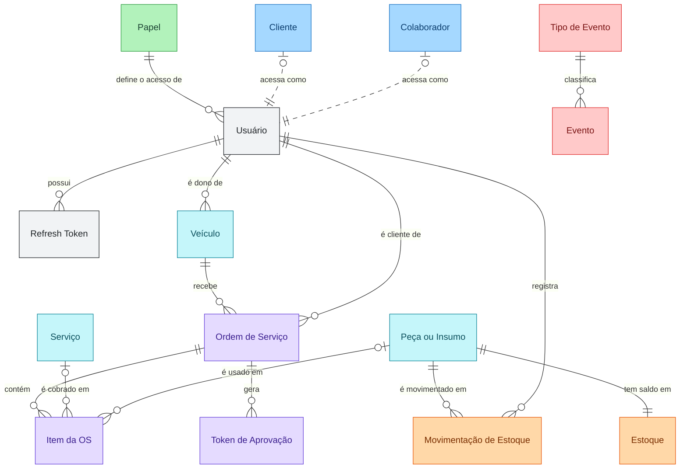
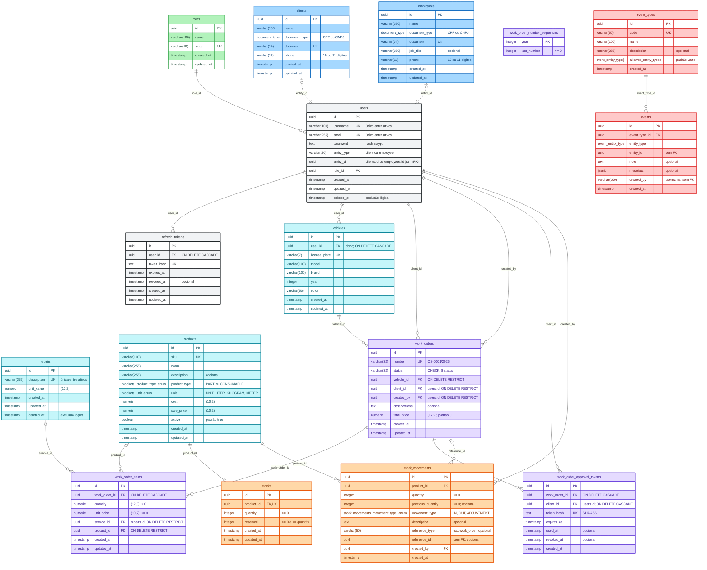

# Modelo de Dados

Modelo de dados do **Sistema de Gestão da Oficina Mecânica** (PostgreSQL 18). O schema é criado e versionado pelas migrations do TypeORM em [`backend/src/infrastructure/database/typeorm/migrations`](../../backend/src/infrastructure/database/typeorm/migrations) (`synchronize: false`), que são a fonte deste documento.

O documento tem duas visões:

1. **[DER conceitual](#1-der-conceitual):** entidades e relacionamentos, com cardinalidade, sem colunas.
2. **[DER físico](#2-der-físico):** as 16 tabelas, como existem no PostgreSQL, com colunas, tipos, chaves e constraints.

## Escopos

As cores separam as tabelas por escopo, nos dois diagramas:

| Cor | Escopo | Tabelas |
|---|---|---|
| Verde | Permissão de acesso | `roles` |
| Cinza | Usuário de login | `users`, `refresh_tokens` |
| Azul | Dados cadastrais (tipo do usuário) | `clients`, `employees` |
| Roxo | Ordem de Serviço (domínio principal) | `work_orders`, `work_order_items`, `work_order_approval_tokens`, `work_order_number_sequences` |
| Ciano | Objetos do domínio principal (dependências do serviço realizado) | `vehicles`, `repairs`, `products` |
| Laranja | Controle de estoque | `stocks`, `stock_movements` |
| Vermelho | Event Store | `event_types`, `events` |

## 1. DER conceitual

> **Imagem:** [der-conceitual.png](der-conceitual.png), com fundo branco e a legenda de escopos.
>
> **Notação:** pé de galinha (crow's foot). `||` = exatamente um, `|o` = zero ou um, `o{` = zero ou mais. A linha tracejada é uma referência **sem chave estrangeira** (ver [Referências polimórficas](#referências-polimórficas)).
>
> Para não poluir o diagrama, ficaram de fora: o vínculo de `Evento` com a entidade auditada (polimórfico, vale para quase todas as entidades), o colaborador que abriu a OS (`work_orders.created_by`) e a referência da movimentação de estoque à OS que a originou. Todos estão no [DER físico](#2-der-físico).

### Entidades

| Entidade | Tabela | Descrição |
|---|---|---|
| Papel | `roles` | Papel de acesso: `admin`, `staff`, `client`. |
| Usuário | `users` | Credencial de acesso. Aponta para o perfil de Cliente ou de Colaborador. |
| Cliente / Colaborador | `clients` / `employees` | Dados cadastrais do perfil (nome, CPF/CNPJ, telefone). |
| Refresh Token | `refresh_tokens` | Sessão de login renovável. |
| Veículo | `vehicles` | Veículo do cliente (placa, marca, modelo, ano). |
| Serviço | `repairs` | Catálogo de serviços da oficina, com valor unitário. |
| Peça ou Insumo | `products` | Catálogo de peças (`PART`) e insumos (`CONSUMABLE`). |
| Estoque | `stocks` | Saldo atual de cada produto: quantidade e reservado. |
| Movimentação de Estoque | `stock_movements` | Histórico de entradas, saídas e ajustes. |
| Ordem de Serviço | `work_orders` | OS de um veículo, com status e valor total. |
| Item da OS | `work_order_items` | Serviço ou peça/insumo incluído no orçamento da OS. |
| Token de Aprovação | `work_order_approval_tokens` | Link de uso único enviado por e-mail para aprovar ou recusar o orçamento. |
| Tipo de Evento / Evento | `event_types` / `events` | Histórico de auditoria (Event Store) de todas as entidades. |

A tabela técnica `work_order_number_sequences` (contador do número da OS) não é uma entidade do domínio e aparece só no DER físico.

## 2. DER físico

> **Imagem:** [der-fisico.png](der-fisico.png), com fundo branco e a legenda de escopos (alta resolução, para ampliar).
>
> **Notação:** `PK` = chave primária, `FK` = chave estrangeira, `UK` = único. Os tipos seguem o PostgreSQL; a precisão de `numeric` aparece no comentário, ex.: `(10,2)`. Os `timestamp` são `NOT NULL DEFAULT now()`, exceto os marcados como opcionais.

## 3. Regras do schema

### Referências polimórficas

Três colunas apontam para mais de uma tabela e, por isso, **não têm chave estrangeira**. A integridade é garantida pela aplicação.

| Coluna | Aponta para | Discriminador |
|---|---|---|
| `users.entity_id` | `clients.id` ou `employees.id` | `users.entity_type` (`client`, `employee`), com índice em `(entity_type, entity_id)` |
| `events.entity_id` | a entidade auditada (`client`, `employee`, `user`, `vehicle`, `product`, `stock`, `repair`, `work_order`) | `events.entity_type`, com índice em `(entity_type, entity_id)` |
| `stock_movements.reference_id` | o registro que originou a movimentação (ex.: a OS, no consumo de peças) | `stock_movements.reference_type` |

Além disso, `events.created_by` guarda o **username** de quem gerou o evento, como texto e sem chave estrangeira. A FK para `users(username)` existia e foi removida junto com a introdução da exclusão lógica: o username deixou de ser único em toda a tabela (só entre ativos), e o registro de auditoria precisa manter o valor original.

### Constraints de negócio

| Tabela | Regra |
|---|---|
| `work_orders` | `status` ∈ `received`, `under_diagnosis`, `awaiting_approval`, `approved`, `in_progress`, `completed`, `delivered`, `cancelled` |
| `work_order_items` | Exatamente um entre `service_id` e `product_id` é preenchido; `quantity > 0`; `unit_price >= 0` |
| `stocks` | `quantity >= 0`, `reserved >= 0` e `reserved <= quantity`; um saldo por produto (`product_id` único) |
| `stock_movements` | `quantity >= 0` e `previous_quantity >= 0` |
| `clients`, `employees` | `phone` com 10 ou 11 dígitos; `document` único |
| `users` | `entity_type` ∈ `client`, `employee` |

### Exclusão lógica

`users` e `repairs` têm `deleted_at`. A unicidade de `users.username`, `users.email` e `repairs.description` vale só entre os registros ativos (índices únicos parciais com `WHERE deleted_at IS NULL`), para que um registro excluído não bloqueie um novo com o mesmo valor.

### Numeração da OS

`work_order_number_sequences` guarda o último número usado em cada ano. O número da OS (`OS-0001/2026`) é gerado com um `INSERT ... ON CONFLICT DO UPDATE` atômico nessa tabela, sem risco de duplicidade em criações simultâneas.

### Índices

Além das chaves primárias e dos únicos:

- `users (entity_type, entity_id)`, `refresh_tokens (user_id)`;
- `work_orders (status, created_at)` e `work_orders (client_id, created_at)`, usados nas listagens e nos indicadores;
- `work_order_items (work_order_id)`, `work_order_approval_tokens (work_order_id)`;
- `events (entity_type, entity_id)`, `events (event_type_id)`, `events (created_at DESC)` e índice GIN em `events (metadata)`.

## 4. Relação com o domínio

| Agregado / conceito | Tabelas |
|---|---|
| Ordem de Serviço (raiz) | `work_orders`, `work_order_items`, `work_order_approval_tokens`, `work_order_number_sequences` |
| Estoque | `products`, `stocks`, `stock_movements` |
| Cadastros | `vehicles`, `repairs` |
| Identidade e Acesso | `users`, `clients`, `employees`, `roles`, `refresh_tokens` |
| Histórico de Eventos | `event_types`, `events` |

## Referências

- [ADR-002 — Escolha do Banco de Dados Principal](../adr/adr-002-banco-dados.md)
- [ADR-004 — Escolha do ORM da Aplicação](../adr/adr-004-escolha-orm.md)
- [ADR-008 — Eventos de Domínio e Registro de Auditoria](../adr/adr-008-eventos-dominio-auditoria.md)
- [C4 — Nível 2: Diagrama de Containers](../c4/02-container.md)
