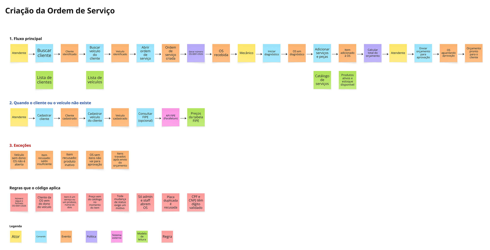
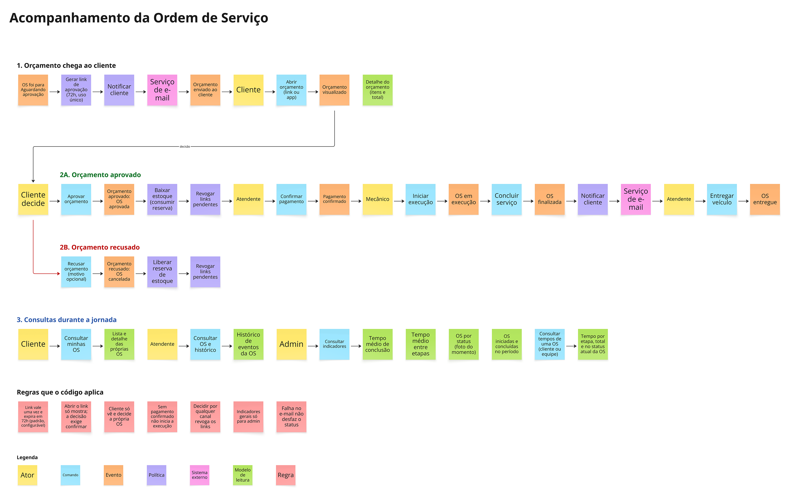
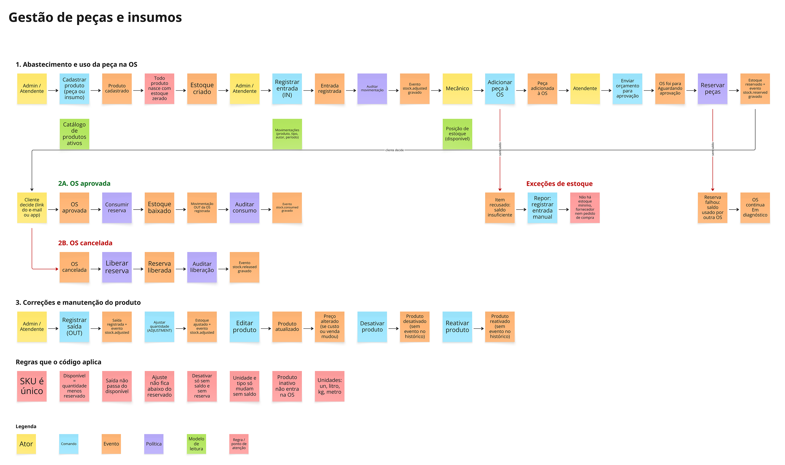

# Documentação DDD

Documentação de Domain-Driven Design do **Sistema de Gestão da Oficina Mecânica**: Event Storming, diagramas do domínio e Linguagem Ubíqua.

O Event Storming e os diagramas foram feitos no Miro. Esta pasta guarda a versão exportada, que corresponde ao código entregue.

**Board no Miro:** <https://miro.com/app/board/uXjVHqLxLfU=/?share_link_id=339330681728>

## Conteúdo

| Documento | Arquivo | O que contém |
|---|---|---|
| Event Storming | [Criação da OS](event-storming-1-criacao-os.png) · [Acompanhamento da OS](event-storming-2-acompanhamento-os.png) · [Peças e insumos](event-storming-3-pecas-insumos.png) | Fluxos de criação da OS, acompanhamento da OS e gestão de peças e insumos, exportados do Miro |
| Domain Storytelling | [domain-storytelling.md](domain-storytelling.md) | Histórias do atendimento: o processo atual (AS IS) e, com o sistema (TO BE), a abertura da OS, a aprovação e execução e a recusa do orçamento |
| Modelo de Domínio | [modelo-de-dominio.md](modelo-de-dominio.md) · [Context Map (PNG)](context-map.png) | Bounded contexts, Context Map, agregados, entidades e objetos de valor |
| Eventos de Domínio | [eventos-de-dominio.md](eventos-de-dominio.md) | Catálogo dos 33 eventos de domínio, metadados, registro de auditoria e reações (políticas) |
| Linguagem Ubíqua | [linguagem-ubiqua.md](linguagem-ubiqua.md) | Termos do domínio por categoria, com o termo usado no código, definição e exemplo |
| Glossário | [glossario.md](glossario.md) | Principais termos do domínio em ordem alfabética, para consulta rápida |

## Event Storming

O Event Storming foi feito para os três fluxos principais do sistema. Cada board mostra atores, comandos, eventos de domínio, políticas, sistemas externos e modelos de leitura, além das exceções e das regras que o código aplica. Os agregados estão no [Modelo de Domínio](modelo-de-dominio.md#3-agregados).

| Cor | Elemento |
|---|---|
| Amarelo | Ator |
| Azul | Comando |
| Laranja | Evento |
| Roxo | Política |
| Rosa | Sistema externo |
| Verde | Modelo de leitura |
| Vermelho | Regra / ponto de atenção |

### Criação da Ordem de Serviço

Da identificação do cliente por CPF/CNPJ e do veículo até o envio do orçamento para aprovação, passando pelo diagnóstico e pela inclusão de serviços, peças e insumos. Inclui o cadastro de cliente e veículo quando eles ainda não existem, a consulta à tabela FIPE e as exceções da abertura da OS.

### Acompanhamento da Ordem de Serviço

Do envio do orçamento por e-mail à entrega do veículo: decisão do cliente (aprovação ou recusa, pelo link do e-mail ou pela API), pagamento, execução, finalização e notificações. Inclui as consultas do cliente, da equipe e do administrador durante a jornada.

### Gestão de peças e insumos

Cadastro de peças e insumos e controle do estoque: entradas, reserva no envio do orçamento, baixa na aprovação, liberação no cancelamento, correções manuais e manutenção do produto. Inclui as exceções de saldo insuficiente.

## Modelo de Domínio

O [Modelo de Domínio](modelo-de-dominio.md) descreve como o domínio está dividido e modelado no código:

- **Bounded Contexts:** Atendimento / Ordem de Serviço (core), Estoque, Cadastros, Identidade e Acesso, Notificações, Histórico de Eventos e Indicadores.
- **Context Map:** as relações entre os contextos (Customer/Supplier, Conformist, Published Language, Anticorruption Layer) e com os sistemas externos Resend e FIPE.
- **Agregados:** Ordem de Serviço, Produto, Estoque, Movimentação de Estoque, Veículo, Serviço, Usuário, Evento e Tipo de Evento, com as invariantes de cada um.
- **Entidades e objetos de valor:** as entidades de domínio, os conceitos tratados como registros e os objetos de valor `Cpf`, `Cnpj` e `Phone`.

## Eventos de Domínio

O catálogo de [Eventos de Domínio](eventos-de-dominio.md) lista os 33 eventos publicados pelo código, no formato `{contexto}.{ação}` (ex.: `work_order.status_changed`, `stock.reserved`), com os metadados de cada um. Também descreve como os eventos são gravados no histórico de auditoria e quais reações (políticas) eles disparam, como o envio do orçamento por e-mail.

## Linguagem Ubíqua

A [Linguagem Ubíqua](linguagem-ubiqua.md) é o vocabulário compartilhado entre o negócio e o código. Cada termo traz o nome usado no código, a definição e um exemplo. Os termos estão agrupados em:

1. **Entidades principais:** Cliente, Veículo, Ordem de Serviço, Serviço, Peça/Insumo, Item da OS, Estoque, Movimentação de Estoque, Colaborador, Usuário, Papel, Evento e Tipo de Evento.
2. **Status da OS:** Recebida, Em diagnóstico, Aguardando aprovação, Aprovada, Em execução, Finalizada, Entregue e Cancelada.
3. **Atributos e valores:** Número da OS, Orçamento, Preço Total, Preço unitário, Subtotal, Valor do serviço, Custo e Preço de venda, Tipo de produto, Unidade de medida, Quantidade reservada e disponível, CPF/CNPJ, Placa e Telefone.
4. **Processos e operações:** Abertura da OS, Inclusão de item, Mudança de status, Envio do orçamento, Aprovação e Recusa, Confirmação de pagamento, Reserva, Baixa e Liberação de estoque, Movimentação manual e Notificação do cliente.
5. **Segurança e controle de acesso:** Papel, Token de acesso (JWT), Refresh token e Link de aprovação.

## Glossário

O [Glossário](glossario.md) reúne, em ordem alfabética, os principais termos do domínio com definições curtas. Além dos termos do negócio (Orçamento, Insumo, SKU, Tabela FIPE, Placa Mercosul...), inclui os conceitos de DDD usados nesta documentação (Agregado, Bounded Context, Evento de domínio, Política).

## Relação com o código

Como os principais termos do domínio aparecem na implementação ([`backend/src`](../../backend/src)):

| Termo do domínio | Código | Onde |
|---|---|---|
| Ordem de Serviço | `WorkOrder` | [`domain/entities/work-order.entity.ts`](../../backend/src/domain/entities/work-order.entity.ts) |
| Item da OS | `WorkOrderItem` | [`domain/entities/work-order-item.entity.ts`](../../backend/src/domain/entities/work-order-item.entity.ts) |
| Status da OS | `WorkOrderStatus` | [`domain/entities/work-order-status.enum.ts`](../../backend/src/domain/entities/work-order-status.enum.ts); regras de transição em `WorkOrder.changeStatus` |
| Número da OS | `OS-0001/2026` | [`typeorm-work-order-number-generator.ts`](../../backend/src/infrastructure/database/typeorm/services/typeorm-work-order-number-generator.ts) |
| Orçamento | `WorkOrderQuoteService` | [`application/services/work-order-quote.service.ts`](../../backend/src/application/services/work-order-quote.service.ts) |
| Aprovação | use cases de `work-order-approvals` | [`application/use-cases/work-order-approvals`](../../backend/src/application/use-cases/work-order-approvals) |
| Cliente / Colaborador | perfis `client` / `employee` do `User` | [`domain/entities/user.entity.ts`](../../backend/src/domain/entities/user.entity.ts) |
| Veículo | `Vehicle` | [`domain/entities/vehicle.entity.ts`](../../backend/src/domain/entities/vehicle.entity.ts) |
| Serviço | `Repair` | [`domain/entities/repair.entity.ts`](../../backend/src/domain/entities/repair.entity.ts) |
| Peças/Insumos | `Product` (`PART`, `CONSUMABLE`) | [`domain/entities/product.entity.ts`](../../backend/src/domain/entities/product.entity.ts) |
| Estoque | `Stock` | [`domain/entities/stock.entity.ts`](../../backend/src/domain/entities/stock.entity.ts) |
| Movimentação de Estoque | `StockMovement` (`IN`, `OUT`, `ADJUSTMENT`) | [`domain/entities/stock-movement.entity.ts`](../../backend/src/domain/entities/stock-movement.entity.ts) |
| Reserva / Baixa de estoque | `Stock.reserve`, `Stock.consumeReservation`; eventos `stock.reserved`, `stock.consumed` | [`work-order-transaction.helpers.ts`](../../backend/src/application/use-cases/work-orders/work-order-transaction.helpers.ts) |
| Evento | `DomainEvent`, `Event` | [`domain/events`](../../backend/src/domain/events), [`domain/entities/event.entity.ts`](../../backend/src/domain/entities/event.entity.ts) |
| Papel | `admin`, `staff`, `client`; `@Roles` + `RolesGuard` | [`infrastructure/http/auth`](../../backend/src/infrastructure/http/auth) |

Como os bounded contexts viraram componentes da API e como as entidades viraram tabelas:

- [C4 — Nível 3: Diagrama de Componentes](../c4/03-component.md)
- [Modelo de Dados](../database/README.md)
