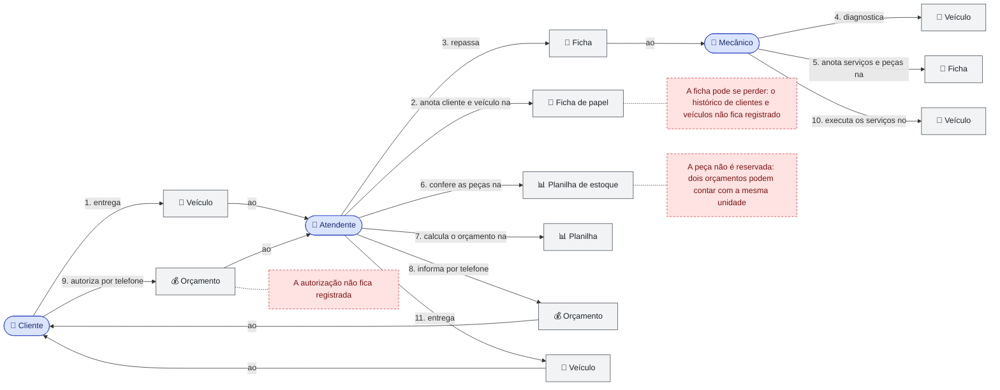
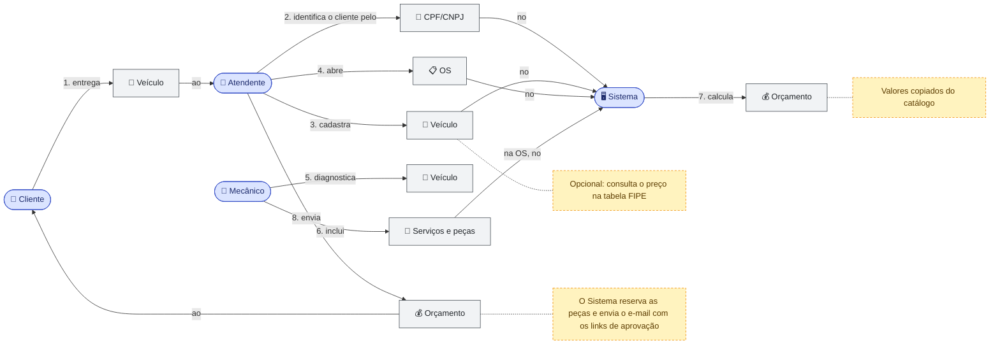
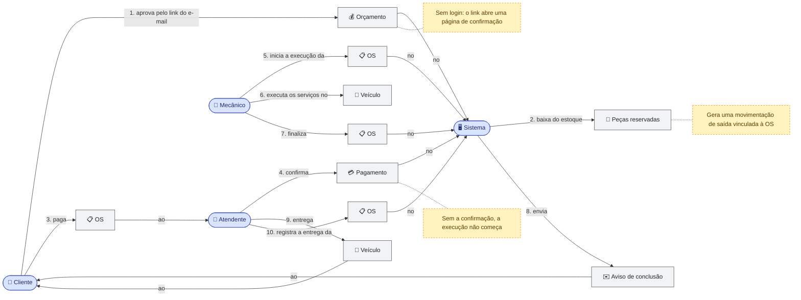
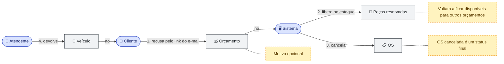

# Domain Storytelling

Histórias do domínio da oficina contadas na notação de **Domain Storytelling**: atores executam atividades sobre objetos de trabalho, em frases numeradas na ordem em que acontecem. As histórias complementam o [Event Storming](README.md#event-storming): enquanto o Event Storming parte dos eventos, aqui o ponto de partida é quem faz o quê.

São quatro cenários. O primeiro mostra o atendimento **como é hoje** (AS IS), a partir das dores relatadas pela oficina; os outros três mostram o atendimento **como passa a ser** com o sistema (TO BE). Como a notação não tem condicionais nem retornos, aprovação e recusa do orçamento são cenários separados.

## Como ler

| Elemento | Representação | Exemplo |
|---|---|---|
| **Ator** | Forma arredondada, em azul; aparece uma única vez por história | 👤 Atendente, 🖥️ Sistema |
| **Objeto de trabalho** | Retângulo, em cinza; aparece em cada frase em que é usado | 🚗 Veículo, 📋 OS, 💰 Orçamento |
| **Atividade** | Seta numerada com o verbo; a segunda seta traz a preposição até o destinatário | **1.** Cliente **entrega** Veículo **ao** Atendente |
| **Anotação** | Caixa tracejada em amarelo | Regra ou detalhe da atividade |
| **Problema** | Caixa tracejada em vermelho (só no AS IS) | Dor do processo atual |

> **Notação.** Os diagramas usam `flowchart` do Mermaid para representar a notação do Domain Storytelling, para que fiquem versionados junto com a documentação. Os PNGs usam o layout **ELK**, que organiza melhor as setas; no GitHub, os blocos aparecem com o layout padrão (ver [Atualizar os diagramas](../c4/README.md#atualizar-os-diagramas)).

## 1. AS IS — Atendimento atual

1. O **Cliente** entrega o **Veículo** ao **Atendente**.
2. O **Atendente** anota os dados do cliente e do veículo na **Ficha de papel**.
3. O **Atendente** repassa a **Ficha** ao **Mecânico**.
4. O **Mecânico** diagnostica o **Veículo**.
5. O **Mecânico** anota os serviços e as peças na **Ficha**.
6. O **Atendente** confere as peças na **Planilha de estoque**.
7. O **Atendente** calcula o orçamento na **Planilha**.
8. O **Atendente** informa o **Orçamento** por telefone ao **Cliente**.
9. O **Cliente** autoriza o **Orçamento** por telefone ao **Atendente**.
10. O **Mecânico** executa os serviços no **Veículo**.
11. O **Atendente** entrega o **Veículo** ao **Cliente**.

> **Imagem:** [domain-storytelling-1-atendimento-as-is.png](domain-storytelling-1-atendimento-as-is.png)

## 2. TO BE — Abertura da OS e envio do orçamento

1. O **Cliente** entrega o **Veículo** ao **Atendente**.
2. O **Atendente** identifica o cliente pelo **CPF/CNPJ** no **Sistema**.
3. O **Atendente** cadastra o **Veículo** no **Sistema**.
4. O **Atendente** abre a **OS** no **Sistema**.
5. O **Mecânico** diagnostica o **Veículo**.
6. O **Mecânico** inclui os **Serviços e peças** na OS, no **Sistema**.
7. O **Sistema** calcula o **Orçamento**.
8. O **Atendente** envia o **Orçamento** ao **Cliente**.

> **Imagem:** [domain-storytelling-2-abertura-orcamento.png](domain-storytelling-2-abertura-orcamento.png)

## 3. TO BE — Aprovação, pagamento, execução e entrega

1. O **Cliente** aprova o **Orçamento** pelo link do e-mail, no **Sistema**.
2. O **Sistema** baixa as **Peças reservadas** do estoque.
3. O **Cliente** paga a **OS** ao **Atendente**.
4. O **Atendente** confirma o **Pagamento** no **Sistema**.
5. O **Mecânico** inicia a execução da **OS** no **Sistema**.
6. O **Mecânico** executa os serviços no **Veículo**.
7. O **Mecânico** finaliza a **OS** no **Sistema**.
8. O **Sistema** envia o **Aviso de conclusão** ao **Cliente**.
9. O **Atendente** entrega o **Veículo** ao **Cliente**.
10. O **Atendente** registra a entrega da **OS** no **Sistema**.

> **Imagem:** [domain-storytelling-3-aprovacao-execucao.png](domain-storytelling-3-aprovacao-execucao.png)

## 4. TO BE — Recusa do orçamento

1. O **Cliente** recusa o **Orçamento** pelo link do e-mail, no **Sistema**.
2. O **Sistema** libera as **Peças reservadas** no estoque.
3. O **Sistema** cancela a **OS**.
4. O **Atendente** devolve o **Veículo** ao **Cliente**.

> **Imagem:** [domain-storytelling-4-recusa.png](domain-storytelling-4-recusa.png)

## Relação com o restante da documentação

| Na história | No domínio | Onde |
|---|---|---|
| Atendente, Mecânico | Papel `staff` | [C4 — Nível 1](../c4/01-system-context.md#pessoas) |
| Cliente | Papel `client` | [C4 — Nível 1](../c4/01-system-context.md#pessoas) |
| OS, Orçamento, Serviços e peças | Agregado Ordem de Serviço e seus itens | [Modelo de Domínio](modelo-de-dominio.md#3-agregados) |
| Peças reservadas | Agregado Estoque (reserva, baixa e liberação) | [ADR-010](../adr/adr-010-reserva-estoque-orcamento.md) |
| Veículo, CPF/CNPJ | Agregados Veículo e Usuário; objetos de valor `Cpf` e `Cnpj` | [Modelo de Domínio](modelo-de-dominio.md#5-objetos-de-valor) |
| Link do e-mail, Aviso de conclusão | Política de notificação (`WorkOrderNotificationHandler`) | [Eventos de Domínio](eventos-de-dominio.md#reações-a-eventos) |
| Atividades numeradas | Comandos e eventos do Event Storming | [Event Storming](README.md#event-storming) |

Os termos usados nas histórias seguem a [Linguagem Ubíqua](linguagem-ubiqua.md).
