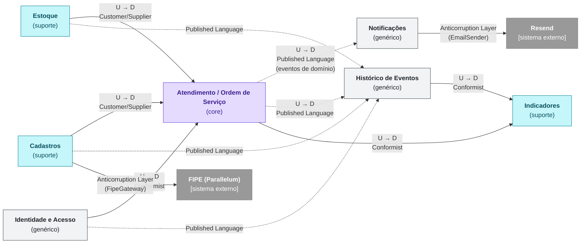

# Modelo de Domínio

Modelo de domínio do **Sistema de Gestão da Oficina Mecânica**: bounded contexts, Context Map, agregados, entidades e objetos de valor, conforme a implementação em [`backend/src`](../../backend/src).

Os termos usados aqui estão definidos na [Linguagem Ubíqua](linguagem-ubiqua.md) e no [Glossário](glossario.md).

## 1. Bounded Contexts

O sistema é um monólito: os contextos são divisões lógicas do código, que compartilham o mesmo processo e o mesmo banco. Cada contexto corresponde a um ou mais componentes do [C4 — Nível 3](../c4/03-component.md).

| Bounded Context | Tipo | Responsabilidade | Agregados | Código |
|---|---|---|---|---|
| **Atendimento / Ordem de Serviço** | Core | Abertura da OS, itens, orçamento, aprovação ou recusa pelo cliente, pagamento e ciclo de status. | Ordem de Serviço | `use-cases/work-orders`, `use-cases/work-order-approvals` |
| **Estoque** | Suporte | Catálogo de peças e insumos, saldos, reservas e movimentações. | Produto, Estoque, Movimentação de Estoque | `use-cases/products`, `use-cases/stock` |
| **Cadastros** | Suporte | Veículos dos clientes (com preço FIPE) e catálogo de serviços. | Veículo, Serviço | `use-cases/vehicles`, `use-cases/repairs` |
| **Identidade e Acesso** | Genérico | Usuários, perfis de Cliente e Colaborador, papéis, login e sessões. | Usuário | `use-cases/auth`, `use-cases/users`, `use-cases/permissions` |
| **Notificações** | Genérico | Envio de e-mails ao cliente em reação aos eventos da OS. | — (reage a eventos) | `event-handlers/work-order-notification.handler.ts`, `services/email` |
| **Histórico de Eventos** | Genérico | Registro de auditoria de todos os eventos de domínio. | Evento, Tipo de Evento | `use-cases/events`, `event-handlers/*-event-audit.handler.ts` |
| **Indicadores** | Suporte | Estatísticas das OS e tempos de cada etapa, calculados a partir do histórico. | — (modelo de leitura) | `use-cases/work-order-stats` |

> **Core** é onde está o diferencial do negócio; **suporte** é necessário ao core, mas específico da oficina; **genérico** é um problema comum a qualquer sistema (acesso, e-mail, auditoria).
>
> O perfil do **Cliente** fica em Identidade e Acesso, e não em Cadastros: por decisão do time, ele é cadastrado junto com o usuário de acesso (`/users`).

## 2. Context Map

> **Notação:** a seta vai do contexto *upstream* (U), que fornece o modelo, para o *downstream* (D), que depende dele. Setas contínuas são chamadas diretas; setas pontilhadas são eventos de domínio publicados em memória.
>
> Versão em imagem, com layout mais legível: [context-map.png](context-map.png).

| Relação | Padrão | Como aparece no código |
|---|---|---|
| Estoque → Ordem de Serviço | Customer/Supplier | A OS usa o Estoque para validar o saldo ao incluir uma peça e para reservar, baixar e liberar na mudança de status, na mesma transação (`WorkOrderUnitOfWork`). O preço de venda é copiado para o item da OS no momento da inclusão. |
| Cadastros → Ordem de Serviço | Customer/Supplier | A OS é aberta a partir de um Veículo (o cliente é o dono do veículo) e inclui Serviços do catálogo, copiando o valor do serviço para o item. |
| Identidade e Acesso → Ordem de Serviço | Conformist | A OS usa o Usuário como está: o cliente e o colaborador responsável são IDs de `users`, e o acesso segue os papéis `admin`, `staff` e `client`. |
| Ordem de Serviço → Notificações | Published Language | Notificações não conhece os use cases da OS: reage a `work_order.status_changed` e envia os e-mails de orçamento e de conclusão. |
| Todos → Histórico de Eventos | Published Language | Os contextos publicam eventos no formato comum `{contexto}.{ação}` (ex.: `stock.reserved`), herdeiros de `DomainEvent`, que os handlers de auditoria gravam na tabela `events`. |
| Histórico e Ordem de Serviço → Indicadores | Conformist | Indicadores lê as OS e o histórico de status como estão, sem modelo próprio. |
| Notificações → Resend | Anticorruption Layer | A porta `EmailSender` isola o domínio da API do Resend; só `ResendEmailSender` conhece o SDK. |
| Cadastros → FIPE | Anticorruption Layer | A porta `FipeGateway` isola o domínio da API da Parallelum; só `ParallelumFipeGateway` conhece o formato externo. |

Além dessas relações, todos os contextos compartilham um **Shared Kernel** pequeno: a classe base `DomainEvent`, os tipos `DocumentType` e `EventEntityType` e os utilitários de paginação (`shared/pagination`).

## 3. Agregados

Um agregado é um grupo de objetos alterado como uma unidade, sempre pela raiz, que garante as regras (invariantes) do grupo. Os agregados se referenciam **apenas por ID**.

| Agregado (raiz) | Contexto | Entidades internas | Invariantes | Referências (por ID) |
|---|---|---|---|---|
| **Ordem de Serviço** (`WorkOrder`) | Atendimento / OS | Item da OS (`WorkOrderItem`) | Só aceita as transições de status permitidas; só vai para Aguardando aprovação com ao menos um item; os itens só mudam antes do envio do orçamento (Recebida ou Em diagnóstico); um item não entra duas vezes; o valor total é sempre a soma dos subtotais; cada item é um serviço **ou** uma peça/insumo, com quantidade maior que zero (inteira, para peças e insumos). | Veículo, Usuário (cliente e colaborador), Serviço e Produto (nos itens) |
| **Produto** (`Product`) | Estoque | — | SKU obrigatório e único; custo e preço de venda maiores ou iguais a zero; tipo (`PART`, `CONSUMABLE`) e unidade de medida válidos. Produto inativo não entra em novas OS. | — |
| **Estoque** (`Stock`) | Estoque | — | Disponível = quantidade − reservado; reserva até o disponível; baixa e liberação até o reservado; saída manual até o disponível; ajuste nunca abaixo do reservado; quantidades inteiras e positivas. Um saldo por produto. | Produto |
| **Movimentação de Estoque** (`StockMovement`) | Estoque | — | Registro imutável. Tipo `IN`, `OUT` ou `ADJUSTMENT`; quantidade inteira, maior que zero (ou maior ou igual a zero, no ajuste); guarda a quantidade anterior. É aplicada ao Estoque na mesma transação (`Stock.applyMovement`). | Produto, Usuário (autor), registro de origem (ex.: OS) |
| **Veículo** (`Vehicle`) | Cadastros | — | Dono obrigatório; placa no padrão antigo (ABC1234) ou Mercosul (ABC1D23), normalizada e única; ano entre 1886 e o ano seguinte ao atual. | Usuário (dono) |
| **Serviço** (`Repair`) | Cadastros | — | Descrição obrigatória e única entre os serviços ativos; valor do serviço maior ou igual a zero. | — |
| **Usuário** (`User`) | Identidade e Acesso | — (ver perfis em [Entidades](#4-entidades)) | O papel precisa ser compatível com o perfil: Cliente só tem o papel `client`; Colaborador, `staff` ou `admin`. Username e e-mail únicos entre usuários ativos. Exclusão lógica (`deactivate`). | Papel, perfil de Cliente ou Colaborador |
| **Evento** (`Event`) | Histórico de Eventos | — | Registro imutável. O tipo de evento precisa permitir o tipo de entidade a que o evento se refere (`EventType.allowsEntityType`). | Tipo de Evento, entidade auditada (polimórfica) |
| **Tipo de Evento** (`EventType`) | Histórico de Eventos | — | Código único; lista das entidades a que se aplica. | — |

> **Transações entre agregados.** Por regra, cada transação altera um agregado. A exceção deliberada é a mudança de status da OS, que altera a Ordem de Serviço e o Estoque na mesma transação para que reserva, baixa e liberação nunca fiquem pela metade ([ADR-010](../adr/adr-010-reserva-estoque-orcamento.md)). O mesmo vale para Produto + Estoque no cadastro do produto e para Movimentação + Estoque nas movimentações manuais.

O agregado Ordem de Serviço está detalhado em diagrama de classes no [C4 — Nível 4](../c4/04-code.md).

## 4. Entidades

Entidades têm identidade própria (um ID) que se mantém ao longo do ciclo de vida, mesmo que os atributos mudem. Todas ficam em [`domain/entities`](../../backend/src/domain/entities).

| Entidade | Papel no agregado | Identidade | Arquivo |
|---|---|---|---|
| Ordem de Serviço | Raiz | UUID + número legível (`OS-0001/2026`) | `work-order.entity.ts` |
| Item da OS | Interna (da Ordem de Serviço) | UUID | `work-order-item.entity.ts` |
| Produto | Raiz | UUID + SKU | `product.entity.ts` |
| Estoque | Raiz | UUID (um por produto) | `stock.entity.ts` |
| Movimentação de Estoque | Raiz | UUID | `stock-movement.entity.ts` |
| Veículo | Raiz | UUID + placa | `vehicle.entity.ts` |
| Serviço | Raiz | UUID | `repair.entity.ts` |
| Usuário | Raiz | UUID + username | `user.entity.ts` |
| Evento | Raiz | UUID | `event.entity.ts` |
| Tipo de Evento | Raiz | UUID + código | `event-type.entity.ts` |

**Conceitos modelados como registros, sem classe de domínio.** Alguns conceitos do domínio não têm regras próprias além das validações de seus valores, e por isso são tratados como registros pela camada de aplicação, por meio de portas:

| Conceito | Registro | Porta | Observação |
|---|---|---|---|
| Perfil de Cliente / Colaborador | `ProfileRecord` | `ProfileRepository` | Criado junto com o Usuário (`UserRegistrationUnitOfWork`). CPF/CNPJ e telefone são validados pelos objetos de valor antes da gravação. |
| Papel | `RoleRecord` | `RoleRepository` | Catálogo fixo: `admin`, `staff`, `client`. |
| Refresh token | — | `RefreshTokenRepository` | Sessão de login; só o hash é gravado. |
| Token de aprovação | `WorkOrderApprovalTokenRecord` | `WorkOrderApprovalTokenRepository` | Link de uso único do e-mail de orçamento; só o hash é gravado. |

## 5. Objetos de valor

Objetos de valor não têm identidade: são definidos pelo valor, imutáveis e se validam na criação. Ficam em [`domain/value-objects`](../../backend/src/domain/value-objects).

| Objeto de valor | Regras | Uso |
|---|---|---|
| **CPF** (`Cpf`) | 11 dígitos, aceito com ou sem máscara; rejeita dígitos todos iguais; valida os dois dígitos verificadores. Guarda só os dígitos e formata como `000.000.000-00`. | Documento de Cliente e Colaborador pessoa física |
| **CNPJ** (`Cnpj`) | 14 caracteres, aceito com ou sem máscara, inclusive no formato alfanumérico (12 caracteres + 2 dígitos verificadores); rejeita valores repetidos; valida os dígitos verificadores. | Documento de Cliente pessoa jurídica |
| **Telefone** (`Phone`) | 10 ou 11 dígitos, com DDD de dois dígitos que não começa com 0; rejeita dígitos todos iguais; se vier formatado, precisa seguir o padrão `(11) 98765-4321`. Guarda só os dígitos. | Contato de Cliente e Colaborador |

Os três implementam igualdade por valor (`equals`) e formatação (`format`). CPF e CNPJ são validados no cadastro do usuário; o telefone, no cadastro e na alteração.

**Tipos de valor (enumerações).** Conjuntos fechados de valores, sem identidade:

| Tipo | Valores |
|---|---|
| `WorkOrderStatus` | `received`, `under_diagnosis`, `awaiting_approval`, `approved`, `in_progress`, `completed`, `delivered`, `cancelled` |
| `ProductType` | `PART`, `CONSUMABLE` |
| `ProductUnit` | `UNIT`, `LITER`, `KILOGRAM`, `METER` |
| `StockMovementType` | `IN`, `OUT`, `ADJUSTMENT` |
| `DocumentType` | `CPF`, `CNPJ` |
| `EventEntityType` | `client`, `employee`, `user`, `vehicle`, `product`, `stock`, `repair`, `work_order` |

**Valores validados dentro das entidades.** Placa (em `Vehicle`), SKU (em `Product`), Número da OS (gerado pelo `WorkOrderNumberGenerator`) e valores monetários (custo, preço, valor do serviço, total) têm suas regras aplicadas pela própria entidade, como atributos simples, e não como objetos de valor separados.

## Referências

- [C4 — Nível 3: Diagrama de Componentes](../c4/03-component.md)
- [C4 — Nível 4: Diagrama de Código (Ordem de Serviço)](../c4/04-code.md)
- [Modelo de Dados](../database/README.md)
- [ADR-003 — Escolha da Arquitetura da Aplicação](../adr/adr-003-arquitetura.md)
- [ADR-008 — Eventos de Domínio e Registro de Auditoria](../adr/adr-008-eventos-dominio-auditoria.md)
- [ADR-010 — Reserva de Estoque no Envio do Orçamento](../adr/adr-010-reserva-estoque-orcamento.md)
